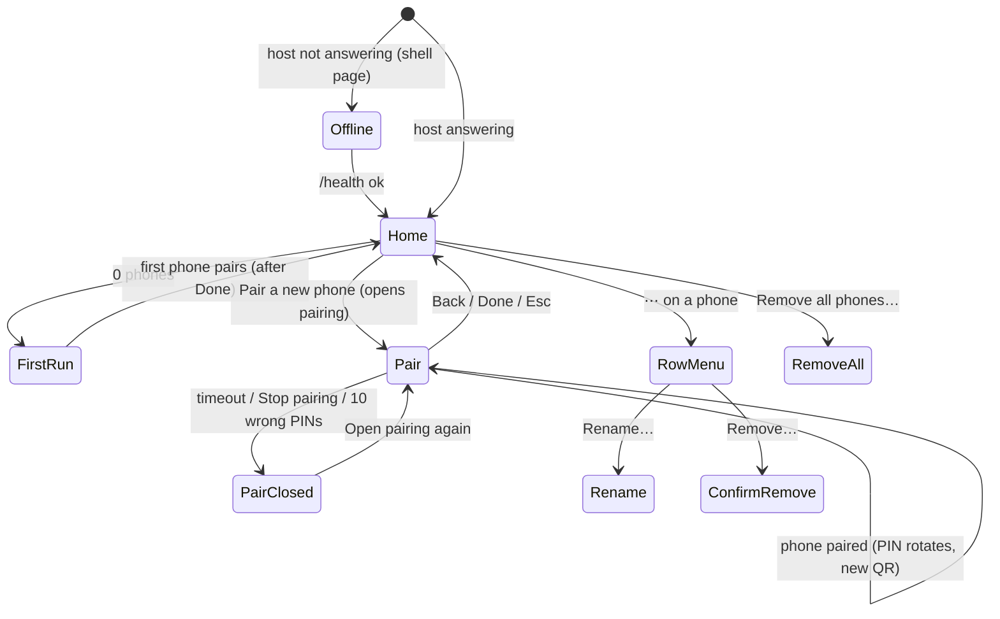

# Host control page and QR pairing: design spec

Status: proposal, 2026-10-21. Scope: the computer-side interface of WinDock (one
loopback-only page shown in a macOS menu-bar popover, the Windows tray flyout, a
detached window and a plain browser), the native menus around it, the QR pairing
payload, and the phone screens added for QR pairing.

- Mockups: [`host-control-mockups.html`](host-control-mockups.html), one frame per
  state. Open with `#solo=<id>` to see one frame at its real size.
- Screenshots: [`screens/host-*.png`](screens/) and [`screens/qr-*.png`](screens/)
  at 2x (index in section 16).
- Builds on: [`PHONE-CONNECTION-FLOW.md`](PHONE-CONNECTION-FLOW.md) (phone tokens,
  pairing screens S5–S10, copy deck), [`../PROTOCOL.md`](../PROTOCOL.md),
  [`../V1-PLAN.md`](../V1-PLAN.md) (to-do "Desktop host interface").
- The QR codes in the mockups are real: they encode the sample payloads in
  section 9.7 and were decoded back from the rendered PNGs (CoreImage), including
  the perspective-skewed camera mockup and a 1x render.

---

## 1. Recommendation in brief

1. **One page, two layouts.** A compact layout at 380 px wide for the macOS
   popover and the Windows tray flyout, and a two-column wide layout from 640 px
   for a detached window or a browser tab. Same HTML, same tokens as the phone
   screens (`#090E10`, mint `#82E8BF`, BrandMark). Per-OS differences are limited
   to font, base size and corner radii (section 3.4).
2. **The page is the app; native menus are shortcuts.** Left-click on the
   menu-bar or tray icon opens the page. Right-click shows a short native menu:
   Open WinDock, Pair a new phone, the Windows capture items, updates (Windows),
   Quit. Settings live only in the page.
3. **Home answers "is it working, and who is connected".** Computer name and
   address, one primary button **Pair a new phone**, the paired phones with live
   "Connected now", and two settings rows. With no phones paired, Home *is* the
   pairing view and pairing opens by itself (decision D1).
4. **Pairing view = the pairing window.** Opening it opens pairing for 10
   minutes (`POST`, never a side-effecting `GET`). It shows a scannable QR, the
   countdown, a Stop pairing action, and the manual fallback (address, security
   code, PIN) in the order the phone asks for them. When pairing closes, the QR is
   **removed**, not dimmed, because a dimmed QR still scans.
5. **QR payload is small and self-verifying.** `windock://pair?v=1&id&addr&fp&pin&name`
   with the host ID and fingerprint in base64url: 146–150 bytes for real names,
   QR version 8 (49 × 49) at error correction M, never above version 9. The phone
   pins the fingerprint from the QR, so scanning replaces the security-code
   comparison.
6. **Phone side: "Scan QR code" is a first-class way in.** iPhone gets an in-app
   VisionKit scanner and also handles the system Camera link; Android hands off to
   the system camera or Lens with a short explainer sheet. Every path lands on one
   confirmation, "Pair with {name}?", before any network traffic.
7. **Host renames are host-only labels.** The phone keeps sending its own name;
   the computer stores an optional `label` beside it (decision D2). This fixes
   "iPhone", "iPhone" and "SM-A405FN" in the list.
8. **Two host security fixes come with it** (section 13.4): local-only routes
   reject cross-site requests (today any web page can reopen pairing and reset
   the wrong-PIN budget with an `` tag pointing at `/api/pairing`), and the
   page is served with a strict CSP and no framing.

---

## 2. Principles used for every call below

- **A control panel you glance at, not an app you live in.** Most visits are
  "is it running?", "pair this phone", "who is that phone?". Each is one look or
  one click from the icon.
- **The pairing window is a security boundary, so the UI makes it visible.** If
  a code is on screen, pairing is open, and the countdown says so. If pairing is
  closed, no code is on screen.
- **Same visual language as the phone screens.** No new colours. Desktop sizes
  are smaller and denser (mouse and keyboard), but every text pair keeps AA
  contrast and every target is at least 28 px (44 px on coarse pointers).
- **Degrade honestly.** In a browser, without a native shell, the page hides
  what it can't do and says where to do it.

---

## 3. Containers and sizes

### 3.1 Containers

| Container | Size | Layout | Open / close | Notes |
| --- | --- | --- | --- | --- |
| **macOS popover** | 380 wide; height follows content, min 320, max `min(680, visibleFrame.height − 40)`, then the page scrolls | compact | Left-click the menu-bar icon toggles. `NSPopover.behavior = .transient` (closes on click outside or Esc) | `popoverShouldDetach` returns true: dragging the popover off detaches it into a window (below). System popover arrow, system open/close animation |
| **macOS detached window** | Opens 380 × current height; resizable, min 360 × 420; remembers frame | compact below 640, wide from 640 | ⋯ → Open in a window, or drag-detach. Close with the red button or ⌘W | `NSPanel`-style utility window, `titlebarAppearsTransparent`, `fullSizeContentView`; page adds a 28 px top inset so its header clears the traffic lights (`WinDockShell.container = "window"`) |
| **Windows tray flyout** | 380 wide (logical px × DPI scale); height as macOS, max `min(680, workArea.height − 24)` | compact | Left-click the tray icon toggles (Windows 11 convention). Hides on deactivate. A click on the icon within 200 ms of the deactivate is swallowed, so clicking the icon while open closes it | Borderless, `TopMost`, not in the taskbar, DWM rounded corners (`DWMWA_WINDOW_CORNER_PREFERENCE = DWMWCP_ROUND`, 8 px). Anchored 12 px from the work-area corner nearest the taskbar (`SHAppBarMessage(ABM_GETTASKBARPOS)`), growing away from the taskbar |
| **Windows window** | Opens 760 × 600, resizable, min 400 × 480, remembers bounds | wide from 640 | ⋯ → Open in a window | Normal window with taskbar button; dark title bar (`DWMWA_USE_IMMERSIVE_DARK_MODE`), caption colour `#090E10` on Windows 11 (`DWMWA_CAPTION_COLOR`), title "WinDock" |
| **Browser** | Any | compact below 640, wide from 640 | `http://127.0.0.1:8620/host` (or `localhost`) on the computer itself | No shell: native-only controls are hidden and replaced by a note (frame 14). A LAN address answers 404 |

The popover and flyout keep their WebView alive while hidden, so reopening is
instant. The shell tells the page when it is shown or hidden (section 13.5) so
the page can pause its live connection.

### 3.2 What lives where

| Item | Native menu | Page | Notes |
| --- | --- | --- | --- |
| Open WinDock | yes | n/a | Default item (bold on Windows) |
| Pair a new phone | yes | primary button | Native item opens the page straight into the pairing view |
| Status, address, version | macOS: one disabled status line | yes | |
| Paired phones, rename, remove | no | yes | |
| Start at login | no | yes (shell only) | One place for settings |
| Network / discovery status | no | yes | |
| Open logs folder | no | ⋯ menu | |
| Check for updates | Windows: yes (exists today) | ⋯ menu (Windows) + banner | macOS: hidden until the Mac app is packaged |
| Restart WinDock | no | ⋯ menu | Shell only |
| Quit WinDock | yes | ⋯ menu | Shell only |
| Stop recording (Windows) | yes, only while recording | banner while recording | |
| Open saved files ▸ Screenshots / Recordings / Signatures (Windows) | yes | no | Kept in the tray as today |
| Show connection info, Copy URL (Windows) | **removed** | replaced by the pairing view and the copy button on Address | Phone copy that names "Show connection info" changes (section 10.9) |

### 3.3 Breakpoints

- **Compact**: below 640 px. One column, 16 px side padding, views pushed and
  popped (Home ⇄ Pair).
- **Wide**: 640 px and up. Header 56 px; a 340 px pairing card on the left and a
  flexible column on the right (identity card with details open, phones, this
  computer), 24 px padding and gap. No view push: the pairing card shows the QR
  when pairing is open and the **Pair a new phone** button when it isn't.
- Content max width in wide: 1040 px, centred.
- The page reflows at 200% browser zoom (wide falls back to compact).

### 3.4 Per-OS differences

Set by `data-os="macos|windows"` on `<html>`: from `WinDockShell.os` in a shell,
else from `navigator.userAgentData.platform` / `navigator.platform`.

| | macOS | Windows |
| --- | --- | --- |
| UI font | `-apple-system` (SF Pro Text) | `"Segoe UI Variable Text", "Segoe UI"` |
| Mono | `ui-monospace` (SF Mono) | `"Cascadia Mono", Consolas` |
| Body / title / caption | 13 / 15 / 12 px | 14 / 16 / 12 px |
| Control radius (`--rc`) | 8 | 4 |
| Group radius (`--rg`) | 10 | 8 |
| Panel / QR tile radius (`--rp`) | 12 | 8 |
| Container corners | system popover | 8 px DWM round |
| Switch | 32 × 18 | 40 × 20 |
| Menu item height | 28 | 32 |
| "Start at login" label | Start at login | Start when I sign in (matches the installer's task) |
| Window title bar | transparent, traffic lights over the page's 28 px inset | native dark title bar |

Accent, colours, spacing, icons and copy are otherwise identical. The Windows
mockups use Open Sans as a stand-in for Segoe UI.

---

## 4. Information architecture



Views (compact):

| View | When | Content top to bottom |
| --- | --- | --- |
| **First run** | 0 paired phones | Header · "Pair your first phone" + one line · QR · countdown · manual details · This computer |
| **Home** | ≥ 1 phone | Header · identity (+ Details) · banners · **Pair a new phone** · Paired phones · This computer |
| **Pair** | after Pair a new phone | Back header · banner (after a pairing) · QR or closed tile · countdown · manual details |
| **Offline** (shell-bundled page) | host not answering | Header with chip · glyph · title · body · detail · actions |

Overlays: row menu, ⋯ menu, Remove all dialog. Inline states: rename field,
remove confirmation.

---

## 5. Screens and states

Sample data: **Geris-MacBook-Air** (macOS, `192.168.1.34:8620`, code
`6E21-B4F0-93AD`) and **DESKTOP-7H2KQ9L** (Windows, `192.168.1.20:8620`, code
`A3F0-5C1E-88D2`). Phones: Geri's iPhone (renamed from "iPhone"), Pixel 8,
SM-A405FN (what a Galaxy A40 reports as `Build.MODEL`).

### 5.1 Header (all views)

- 48 px (56 wide). Left: BrandMark 18 + "WinDock" (body/600). Right: status chip,
  then ⋯ (32 × 32, label "More").
- Pair view: back chevron button (label "Back") + "Pair a new phone" (body/600);
  no chip, no ⋯.
- Status chip (22 px pill, caption/600, always a word plus a dot):

| State | Chip | Colour |
| --- | --- | --- |
| Running, no problems | ● Running | `live` on `accent-tint` |
| Running with a problem from 5.8 | ● Needs attention | `danger-text` on `danger-tint` |
| Restarting | spinner + Restarting | `text-2` on white 6% |
| Offline page: starting | spinner + Starting | same |
| Offline page: stopped | ● Stopped | danger |

### 5.2 Identity block (Home)

- Computer name (title, 1 line, ellipsis; full name in the tooltip). Below, a
  caption line: `192.168.1.34` (mono, text-2) · macOS · WinDock 0.3.0 · **Details ▾**.
- **Details** toggles a definition list (Home only; always open in the wide
  identity card):

| Term | Value |
| --- | --- |
| Address | `http://192.168.1.34:8620` (copy button on hover/focus) |
| Secure address | `https://192.168.1.34:8620` (hidden when TLS is off) |
| Also reachable at | `10.0.0.12 (Ethernet)` per extra address; row hidden when none |
| Older phone apps | Allowed (plain HTTP is on) / Not allowed (plain HTTP is off) |
| Version | WinDock 0.3.0 on macOS |

### 5.3 First run (frame 01)

- Title "Pair your first phone"; body "In WinDock on your phone, tap **Scan QR
  code**, or point the phone's camera at this code."
- QR, countdown, manual details exactly as the Pair view (5.4).
- Below: This computer (5.7). The popover scrolls; a 32 px fade marks the fold.
- Opening the page with 0 phones opens pairing by itself (D1). Removing the last
  phone shows this layout but does **not** reopen pairing; it shows the closed
  tile with **Open pairing for 10 minutes**.
- When the first phone pairs, the success banner (5.4) appears with **Done**;
  Done switches to Home.

### 5.4 Pair view (frames 03, 04, 05, 11)

**Open (03)**

- QR tile 228 × 228 (4 px per module for version 8; 244 for version 9), white,
  radius `--rp`, centred. Caption under it, centred: "Scan with the phone's
  camera, or tap **Scan QR code** in WinDock on the phone."
- Countdown row (36 px, `row` fill, `--rg`): clock icon (accent) + text +
  trailing ghost button.

| Remaining | Text | Action |
| --- | --- | --- |
| ≥ 2 min | Open for **{n} more minutes** (rounded up) | Stop pairing |
| 1–2 min | Open for **1 more minute** | Stop pairing |
| < 60 s | Closes in **less than a minute** | Keep open (reopens: a fresh 10 minutes) |

- Section label "Or enter these on the phone", then a group of three rows (36 px):
  **Address** `192.168.1.34:8620` + copy button · **Security code**
  `6E21-B4F0-93AD` (hyphens text-3) · **PIN** `482 913` (mono 20/500, a thin gap
  after 3 digits; no copy button, so the PIN never reaches the clipboard).
- Caption: "Each PIN pairs one phone. A new one appears after each pairing."

**A phone paired (04)**

- Success banner at the top (accent-tint, accent-line, check icon): "**{phone}
  is paired**" / "The code below is new. Scan it to pair another phone." + **Done**
  (secondary small). Announced politely.
- QR and PIN swap to the new PIN **instantly**. The countdown is not extended.
- The banner stays until Done, Back, or the next pairing (which replaces it).

**Closed (05)**

The QR tile is replaced in place by a tile of the same size (`row` fill, 1 px
`line`), so nothing jumps. Manual details are hidden (the PIN is useless while
closed). Then title, body, actions:

| Why closed | Tile | Title | Body | Actions |
| --- | --- | --- | --- | --- |
| Timeout | clock glyph, "No code while pairing is closed" | Pairing is closed | It closes 10 minutes after it opens, to keep strangers out. | **Open pairing for 10 minutes** (primary) |
| Stop pairing | same | Pairing is closed | You stopped pairing. The old code no longer works. | **Open pairing for 10 minutes** |
| 10 wrong PINs | shield glyph (danger tint), same caption | Pairing closed after 10 wrong PINs | The PIN has been changed. Someone on this network may have been guessing. If it wasn't you, check that every paired phone is yours. | **Open pairing again** (primary) · **See paired phones** (secondary, back to Home) |
| No network address | wifi-off glyph, "No code without a network" | Connect to a network to pair | Phones need {name} on the same Wi-Fi or Ethernet. | none; reopens by itself when an address appears |
| TLS off (`WINDOCK_TLS=0`) | no tile | (manual details only) | Caption above the group: "QR pairing needs HTTPS, which is turned off. Phones can still pair with the address and PIN." Security code row hidden | |

**Under a minute (11)**: countdown switches to "Closes in less than a minute"
with **Keep open**.

### 5.5 Paired phones (frames 02, 06, 07, 08)

- Section label "Paired phones" + count (text-3).
- Order: connected first, then `lastSeenAt` descending; frozen while the page is
  visible (a phone connecting doesn't make rows jump; the order refreshes on the
  next open).
- Row (min 48, padding 7/6/7/12, separators inset 52): glyph 28 (phone; accent
  tint when connected) · name (body/600, 1 line, ellipsis, full name in tooltip)
  over a caption line · trailing ⋯ (28 visual, label "More for {name}"). Right-click
  on the row opens the same menu.
- Caption line:

| State | Caption |
| --- | --- |
| Connected (any open dock socket) | ● Connected now · {phone's own name if renamed, else "Paired {date}"} |
| Seen today | Seen today · … |
| Seen yesterday | Seen yesterday · … |
| Older | Seen {12 Oct} · … (`Intl.DateTimeFormat` day + short month, year added if not this year) |
| Never seen after pairing | Not seen since pairing · Paired {date} |

  `lastSeenAt` is written at most hourly by the host, so the UI never claims
  minute precision. The tooltip and accessible description carry full local
  date-times.
- Footer: ghost small **Remove all phones…** (text-2, right-aligned), shown with 2
  or more phones.
- Many phones (up to 64): the list just grows; the popover scrolls. No search.

**Row menu (06)**: Rename… · Remove… (danger-text). Arrow keys move, Return
picks, Esc closes and returns focus to ⋯.

**Rename (07, top row)**: the name becomes a 30 px field with the text selected.
Caption under it: "Only this computer uses this name. Leave it empty to use
“{phone's name}”." Return or clicking away saves; Esc cancels. Max 40
characters, trimmed; empty restores the phone's name. Saved via `PATCH`; on
failure the field stays with the error "Couldn't save the name. Try again."

**Remove (07, bottom row)**: the row turns `danger-tint`: "Remove {name}?" / "It
needs a new PIN to connect again." (if connected: "It disconnects now and needs a
new PIN to connect again.") + **Cancel** (focused) · **Remove** (danger). On
success the row collapses away. On failure: "Couldn't remove it. Try again."

**Remove all (08)**: the page's only modal. Title "Remove all {n} phones?", body
"They disconnect now, and each one needs a new PIN to connect again. Your dock and
apps stay as they are." **Cancel** (focused, Esc) · **Remove all** (danger).

### 5.6 Banners (Home, under identity)

One at a time, highest first: problem (danger) → recording (Windows) → update.

| Banner | Icon | Title / body | Action |
| --- | --- | --- | --- |
| Firewall blocks node (macOS) | shield, danger | macOS is blocking phones / The firewall stops incoming connections to node, so phones can't reach this Mac. | Open Firewall settings |
| No network address | wifi-off, danger | Not connected to a network / Phones can't reach {name} until it joins Wi-Fi or Ethernet. | none |
| Recording (Windows) | static red dot | Recording your screen / Main monitor, no audio. Saved to Videos\WinDock. | Stop recording |
| Update available (Windows) | download | WinDock {version} is available / You have {installed}. | Download · Later |

### 5.7 This computer

| Row | Control | States (caption) |
| --- | --- | --- |
| Start at login (macOS) / Start when I sign in (Windows) | switch | on / off; macOS **requires approval**: switch on, caption "Waiting for you to allow it in System Settings. **Open Login Items**" (frame 09); unavailable: row hidden. Browser: row hidden |
| Visible on this network | none (status) | both on: "Phones on the same Wi-Fi find it by themselves." · Bonjour failed: "iPhones can't find this computer by themselves right now. They can still connect by address or QR code." · Bonjour off (`WINDOCK_BONJOUR=0`): "Automatic discovery for iPhones is turned off." · UDP failed: "Android phones can't find this computer by themselves right now. They can still connect by address or QR code." · both failed: "Phones can't find this computer by themselves right now. Pair with the QR code or the address." |

**Plain HTTP for older phone apps stays out of the V1 UI** (decision D3). It is
on by default, turning it off silently strands older phone builds, and the only
safe moment to switch it off is once every paired phone uses HTTPS, which the host
can't see yet. It is shown read-only in Details and stays an environment switch.

### 5.8 Problems and the offline page (frames 09, 12)

Detectable while running (from `/api/host/status`): firewall blocking (macOS),
no LAN address, discovery failures, login item pending. Only the first two raise
the chip to Needs attention.

When the host isn't answering, the page can't load, so **each shell bundles a
small offline page** (`offline.html`, same CSS) and shows it. The shell probes
`GET /health` on 127.0.0.1 every 250 ms after spawning; it loads `/host` as soon
as it answers.

| Variant | Chip | Title | Body | Detail | Actions |
| --- | --- | --- | --- | --- | --- |
| Starting (after 400 ms) | Starting | Starting WinDock… | | | |
| Starting > 15 s | Starting | WinDock is taking a while to start | Check the logs if this keeps happening. | | Open logs · Try again |
| Port in use (`EADDRINUSE`) | Stopped | Port {port} is in use | Another app, or another copy of WinDock, is using it. Close that app, then try again. | last stderr line, mono | Try again · Open logs |
| Exited | Stopped | WinDock stopped unexpectedly | Phones can't connect until it's running again. | last stderr line | Restart · Open logs |
| Node.js missing (macOS) | Stopped | Node.js isn't installed | WinDock needs Node.js 20 or newer on this Mac. Install it, then restart WinDock. | | Get Node.js · Restart |

Footer caption on all stopped variants: "Phones can't connect until WinDock is
running." The ⋯ menu on the offline page has Open logs folder and Quit WinDock.

Today the Windows tray shows a message box and exits when the server exits; with
this page it stays in the tray and offers Restart.

**Attach mode.** Before spawning, the shell checks `GET /health` on its port. If
a WinDock host already answers (started from Terminal or by the LaunchAgent), it
attaches instead of failing: the page works normally, but Restart and Quit act on
the shell only, and Home shows a note: "WinDock was started outside this app, so
it can't restart or stop it."

### 5.9 Browser without a shell (frame 14)

- Wide or compact by width. No ⋯ menu (none of its items can work).
- Start at login row hidden. A note replaces native-only items:
  - host started by a shell: "Start at login, logs and quit are in the WinDock
    menu-bar app." (Windows: "…in the WinDock tray icon.")
  - host started from a terminal: "WinDock was started from Terminal. Stop it
    there with Control-C." (Windows: "…from a command prompt. Stop it there with
    Ctrl+C.")
- The host tells which via `status.shell` (section 13.2).

---

## 6. Native menus

### 6.1 macOS menu-bar item

- Icon: 16 pt template image of the four-square mark (filled squares; the
  system tints it). Problem state: the bottom-right square drawn as an outline.
  No colour, per menu-bar conventions.
- Left-click: toggle popover. Right-click or Control-click: menu.
- Tooltip: "WinDock · Running" / "WinDock · Needs attention".

| Item | Behaviour |
| --- | --- |
| Running on 192.168.1.34 *(disabled)* | Status line; "Starting…", "Stopped" or "Not connected to a network" otherwise |
| — | |
| Open WinDock | Opens the popover |
| Pair a new phone… | Opens the popover in the Pair view (opens pairing) |
| — | |
| Quit WinDock ⌘Q | Stops the host it spawned, then quits |

### 6.2 Windows tray

- Icon: existing `WinDock.ico`; problem variant with a small danger dot.
- Left-click: toggle flyout. Double-click: same (no separate action).
- Tooltip (`NotifyIcon.Text`, ≤ 127 chars): "WinDock · Running · 192.168.1.20",
  "WinDock · Recording your screen", "WinDock · Stopped".
- Balloon on first start is replaced by nothing (the flyout carries the info);
  update and recording balloons stay.

| Item | Behaviour |
| --- | --- |
| **Open WinDock** (default) | Opens the flyout |
| Pair a new phone | Opens the flyout in the Pair view |
| — | |
| ● Stop recording | Only visible while recording (today it's a disabled item) |
| Open saved files ▸ Screenshots / Recordings / Signatures | Unchanged |
| — | |
| Check for updates… / Download WinDock {v}… | Unchanged behaviour |
| Quit WinDock | Unchanged (stops a recording first) |

If WebView2 isn't available, Open WinDock and Pair a new phone open
`http://127.0.0.1:{port}/host` in the default browser instead.

---

## 7. Tokens

### 7.1 Colour

No new colours. All from PHONE-CONNECTION-FLOW §6. Desktop uses them like this:

| Token | Desktop use |
| --- | --- |
| `bg` `#090E10` | page/panel background, with `bg-glow` top-left |
| `row` `#13191B` | groups, cards, countdown row, closed tile |
| `row-pressed` `#1A2224` | menus |
| `sheet` `#151D20` | dialog |
| `field` `#171F22` | rename field |
| `line` / `line-strong` | separators / panel, menu and dialog edges |
| `text` / `text-2` / `text-3` | as phone |
| `idle` `#5E6E70` | switch off outline (3.3:1 on row, so the off control is visible), dot separators |
| `accent`, `on-accent`, `accent-tint`, `accent-line` | primary button, links, success banner, connected glyph, focus ring |
| `live` | chip text and connected dot |
| `danger-text`, `danger-tint`, `danger-line` | problem banner, chip, remove confirmation, destructive menu items |
| `scrim` | behind the dialog |
| QR | modules `#090E10` on `#FFFFFF`, always (never inverted, never themed) |
| White 4% / 6% / 8% | row hover / neutral glyph and chip / secondary button and highlighted menu item |

New contrast pairs, all AA: text-3 on `row-pressed` (menus) 4.6:1; text-2 on
menu 7.1:1; danger-text on danger-tint over row 7.6:1; accent on accent-tint
over bg 10.9:1; thumb on switch track 9.7:1; focus ring on row 12.1:1.

### 7.2 Type

| Role | macOS | Windows | Use |
| --- | --- | --- | --- |
| display (wide first run only) | 22/650 | 22/600 | |
| title | 15/600 | 16/600 | computer name, view titles, dialog title |
| body | 13/400, 1.45 | 14/400, 1.45 | explanations, row titles at /600 |
| caption | 12/400, text-3 or text-2 | 12/400 | row captions, hints, section labels at /600 text-2 |
| mono value | 13/400 | 13/400 | address, security code |
| PIN | mono 20/500, +0.06 em | same | |
| chip | 12/600 | 12/600 | |

### 7.3 Spacing, radii, sizes

- Spacing scale: **4, 8, 12, 16, 20, 24** (+ the 2/6/7 px optical nudges inside
  rows, as in the mockup CSS).
- Side padding 16 (compact), 24 (wide). Section label: 20 above, 8 below.
- Heights: header 48 (56 wide); button 36 (small 28); row 48; detail row 36;
  icon button 32 (28 inside rows); switch 18/20; menu item 28/32.
- Radii: section 3.4.
- Pointer: `@media (pointer: coarse)` (Windows touch laptops) raises buttons,
  rows, icon buttons and menu items to 44 px.

---

## 8. Components

| Component | Variants | Notes |
| --- | --- | --- |
| Status chip | ok, attention, busy, stopped | `role="status"` |
| Button | primary, secondary, ghost, danger; small | One primary per view |
| Icon button | plain, active | Always labelled |
| Group + row | phone row, settings row, detail row | Separators inset to text |
| Switch | on, off, pending | `<button role="switch" aria-checked>` |
| QR tile | open, closed (variants in 5.4) | Same footprint in every state |
| Countdown row | normal, last minute | Text only changes at minute boundaries |
| Banner | success, danger, neutral (recording, update) | Optional trailing action |
| Menu | row menu, ⋯ menu | `role="menu"`, roving focus |
| Dialog | Remove all | `<dialog>` with `showModal()`, focus trapped |
| Inline field | rename | |
| Inline confirm | remove | |
| Note | browser / attach | 1 px `line-strong` outline, no fill |
| Offline page | 5.8 variants | Shell-bundled |

The mockup CSS (`h-*` classes in `host-control-mockups.html`) is a usable
starting point for the real stylesheet.

---

## 9. QR payload

### 9.1 Format

```
windock://pair?v=1&id=<hostId>&addr=<ipv4>:<port>&fp=<fingerprint>&pin=<pin>&name=<name>
```

| Field | Encoding | Size | Phone check |
| --- | --- | --- | --- |
| `v` | integer, `1` | 1 | `v > 1` → "This code needs a newer WinDock app." |
| `id` | host ID UUID as 16 raw bytes, base64url, no padding | 22 | Decode to canonical lowercase UUID; must equal `/health.hostId` |
| `addr` | dotted IPv4 + `:` + port, the host's advertised LAN address (same as Bonjour TXT `addr`) | ≤ 21 | Private IPv4 only (10/8, 172.16/12, 192.168/16), port 1–65535; same validator as Add by address |
| `fp` | SHA-256 of the leaf certificate DER, 32 bytes, base64url, no padding | 43 | Constant-time compare with the certificate the TLS handshake presents. Never with `/health` |
| `pin` | 6 ASCII digits | 6 | `^\d{6}$` |
| `name` | host name, control characters removed, percent-encoded (RFC 3986 unreserved kept), truncated on a character boundary to ≤ 32 encoded bytes | ≤ 32 | Display only, in the confirmation |

- Fields are written in this order. Parsers accept any order, ignore unknown
  keys and **reject duplicates** of known keys.
- The security code shown to people stays the first 6 bytes of the fingerprint
  in hex; the phone derives it from `fp` for display.
- Base64url instead of hex saves 35 bytes for `id` + `fp`, which keeps long
  names at version 9 or below (decision D5).

### 9.2 Size and symbol

- Typical length 146–150 bytes → **version 8 (49 × 49)** at error correction
  **M**, byte mode. Maximum with every field at full length: 167 bytes →
  version 9 (53 × 53, capacity 180). Never above 9.
- ECC M recovers about 15% damage: enough for screen glare and moiré without
  the density cost of Q or H.
- No logo in the centre (it would spend the error correction) and no inverted
  colours (some scanners don't read light-on-dark).

### 9.3 Rendering

- Generated on the host (section 13.3) and drawn by the page as one SVG path:
  `viewBox` includes a **4-module quiet zone**, `shape-rendering: crispEdges`.
- **4 CSS px per module**: version 8 = 57 modules × 4 = 228 px; version 9 = 61 ×
  4 = 244 px. The tile is exactly the QR, so modules land on whole pixels at 1x
  and 2x.
- Physical size: about 45 mm on a 13" MacBook Air at default scaling, about
  60 mm on a 24" 1080p monitor at 100% (modules 0.8–1.1 mm). Decoded from both
  1x and 2x renders here; arm's-length scanning on real phones is an open check
  (section 15).
- `forced-color-adjust: none` on the tile, so Windows high contrast never
  recolours it.

### 9.4 Refresh

- The page renders the QR from `GET /api/host/pairing`. It refetches whenever
  `status.pairing.generation` changes. The host bumps `generation` on: pairing
  opened, PIN rotated after a pairing, PIN rotated by the wrong-PIN budget,
  stopped, timed out, LAN address changed.
- On close or timeout the QR element is **removed from the DOM** at once (the
  page also closes it locally when its own countdown reaches 0, without waiting
  for the server).
- The countdown is computed locally from `remainingMs` and `performance.now()`,
  and re-synced on every status event.
- Hidden popover: nothing changes on the host (pairing stays open for its 10
  minutes, a phone may still be mid-PIN); the page pauses its event stream.

### 9.5 Pairing window rules (host)

Unchanged from the user's decisions, plus two details for the UI:

- Opening the Pair view, Pair a new phone in a native menu, Open pairing again,
  Keep open, and auto-open on first run all call `POST /api/host/pairing/open`
  (a full 10 minutes, budget reset, as `reopen()` today).
- **Stop pairing** closes the window **and rotates the PIN**, so a photographed
  code is dead. Timeout keeps the PIN, so a phone waiting on "Pairing is closed"
  can finish with the scanned code when pairing reopens (decision D4).

### 9.6 Security notes

- The QR carries a one-time secret. Anyone who can see the screen while pairing
  is open can pair, exactly as with the PIN today; the window, single use and
  global budget still bound it.
- Pinning `fp` from the QR is stronger than trust on first use: the QR is an
  out-of-band channel from the computer's own screen, which is why scanning can
  skip the security-code comparison.
- A `windock://` link can be crafted by anyone (a web page, a message, another
  app). Defences: the phone asks before any network traffic; `addr` must be
  private; the PIN is sent **only** after the TLS handshake presents `fp`; a known
  host ID with a different `fp` never re-pins silently (Q11); nothing pairs
  automatically.
- QR pairing requires TLS. With `WINDOCK_TLS=0` the host shows no QR.
- Neither side logs the link (it contains the PIN): not the host, not `os_log`,
  not Logcat, not crash reports.
- The page never puts the PIN in a URL, title, notification or the clipboard.
- System camera apps and Lens may keep the link in their history. Acceptable
  because the PIN is single-use and expires with the window; noted for the lead.

### 9.7 Sample payloads (used in the mockups)

```
windock://pair?v=1&id=Ww6POixBTX6aFnPCvk2R8A&addr=192.168.1.34:8620&fp=biG08JOtXwx6EunUs4bxoMJefZtPYwGKLOV7lNPg9qE&pin=482913&name=Geris-MacBook-Air
windock://pair?v=1&id=0FvYxz2KR1yUq3nE8iWbPg&addr=192.168.1.20:8620&fp=o_BcHojSSRew5sNa8o0ed0C5xqXSH4Pgm0xX1qIefAk&pin=315780&name=DESKTOP-7H2KQ9L
```

148 and 146 bytes, both version 8. The fingerprints start `6e21b4f093ad…` and
`a3f05c1e88d2…`, matching the security codes on screen.

---

## 10. Phone side: QR additions

Same frame, tokens and components as PHONE-CONNECTION-FLOW. New screens are
numbered Q1–Q11 (mockups `qr-01` … `qr-11`).

### 10.1 Entry points

| Where | iOS | Android |
| --- | --- | --- |
| Computers hub rail (S2, S3) | **Scan QR code** rail link (QR icon), first, above Add by address | Same, first of four links (rail body text dropped at 844 to fit), frame Q2 |
| First launch, nothing found (replaces S2 empty state) | Glyph QR · "Scan the code on your computer" · "On the computer, open WinDock and choose Pair a new phone. Scanning pairs in one step, even if this phone can't find the computer." · **Scan QR code** (primary) · **Enter an address** (ghost). Rail hides its Scan and Add links while these are visible. Frame Q1 | Same |
| Pairing step 1 (S5) | Ghost link under the buttons: **Scan the QR code instead** (the computer is showing it right next to the security code) | Same |
| iOS Local Network priming (S2) | unchanged; scanning comes after | n/a |
| Switch sheet → Add a computer | opens the hub (unchanged) | same |

"Scan QR code" opens the in-app scanner on iOS and the camera sheet (10.3) on
Android. On iOS devices where `DataScannerViewController.isSupported` is false
(before A12) or `isAvailable` is false (camera restricted), the in-app entry
points become "Use your Camera app" and open a sheet with the Android-style
steps (system Camera still opens the link).

### 10.2 iOS scanner (Q4)

- `DataScannerViewController(recognizedDataTypes: [.barcode(symbologies: [.qr])],
  qualityLevel: .balanced, recognizesMultipleItems: false,
  isHighFrameRateTrackingEnabled: false, isGuidanceEnabled: false,
  isHighlightingEnabled: false)`, full screen, landscape.
- Our overlay: left rail (380 wide, `bg` at 94% fading to clear) with close
  (44 pt filled xmark, "Cancel scanning"), title "Scan the code on your
  computer", body "On the computer, open WinDock and choose Pair a new phone.",
  and **Enter the PIN instead** (ghost, bottom; goes to the hub's discovery list,
  or step 1 if a computer is selected). Viewfinder: 214 pt square, accent corner
  brackets, centred in the camera area. It is guidance only: any WinDock code in
  view is accepted.
- On a `windock://pair` payload: stop scanning, light haptic, brackets settle
  (motion 11), present Q5.
- Any other QR: caption under the viewfinder "That isn't a WinDock code" for 2 s.
  No haptic.
- Camera permission (`NSCameraUsageDescription` = "WinDock uses the camera to
  scan the pairing code on your computer."). Denied: the camera area shows
  "Camera access is off" + **Open Settings**; Enter the PIN instead stays.

### 10.3 Android camera sheet (Q3)

Bottom dialog (as S13, 560 wide). Title "Scan with your camera". Steps: (1) "On
the computer, open WinDock and choose **Pair a new phone**." (2) "Open the camera
and point it at the code." (3) "Tap the link that appears. WinDock opens and asks
before it pairs." Caption: "Nothing appears? Turn on QR scanning in the camera's
settings, or use Google Lens." Buttons: **Enter the PIN instead** (ghost) ·
**Open camera** (primary: `MediaStore.INTENT_ACTION_STILL_IMAGE_CAMERA`; if no
activity resolves, the button is hidden).

### 10.4 Receiving the link

- iOS: `CFBundleURLTypes` scheme `windock`; handle `scene(_:openURLContexts:)`
  and `connectionOptions.urlContexts` at cold start.
- Android: on `MainActivity` (`launchMode="singleTask"`, `onNewIntent`):
  `<intent-filter><action VIEW/><category DEFAULT/><category BROWSABLE/><data android:scheme="windock" android:host="pair"/></intent-filter>`.
- Accept only host `pair`. Parse per 9.1. Malformed: alert "This isn't a WinDock
  pairing code" (OK). Newer `v`: alert "This code needs a newer WinDock app.
  Update the app, or pair with the PIN instead."
- If the app is in the dock of another computer, Q5 is presented over the live
  dock; Cancel returns to it. A link arriving during another pairing replaces it.
- iOS Local Network denied: S11 first, then continue.

### 10.5 Confirmation (Q5, Q6)

Full-screen modal, two columns:

- Left: 56 glyph (monitor, accent) · title "Pair with {name}?" · body "This phone
  will open its dock and can launch apps on it."
- Right: card with **Address** `192.168.1.34:8620` and **Security code**
  `6E21-B4F0-93AD` (mono 15). Caption with shield: "Only pair if you just scanned
  this code on your own computer's screen." Buttons **Pair** (primary, default)
  · **Cancel**.
- Nothing touches the network before Pair.
- Pairing state (Q6): Pair shows a spinner and "Pairing…", disabled; Cancel stays
  and aborts.
- Already paired, same `id` and `fp`, session valid: skip Q5 and open the dock
  (S1 "Opening {name}"); update the saved endpoint if `addr` differs.
- Already paired, same `fp`, session revoked: Q5 titled "Pair {name} again?".
- Already paired, **different `fp`**: Q11 instead of Q5.

### 10.6 What Pair does

1. Connect to `https://{addr}`; require the leaf certificate's SHA-256 to equal
   `fp`; `GET /health`; require `hostId == id` and `pairingOpen`.
2. If no answer in 4 s, or a different certificate answers at `addr`: browse
   Bonjour (both) and UDP (Android) for up to 8 s; accept a result only if its
   handshake presents `fp` and `/health.hostId == id`.
3. `POST /api/auth {pin, deviceName}` over that pinned connection.
4. On 200: pin `fp` for `id`, save the computer, hand the cookie to the WebView,
   show Q7, then the dock (same hand-off as PIN pairing).

### 10.7 Outcomes

| Result | Screen | Copy |
| --- | --- | --- |
| 200 | Q7 | Button row becomes ✓ "Paired. Opening the dock…" (success haptic, ≥ 400 ms), then the dock fades in |
| 401 wrong PIN | Q8 | "This code was already used" / "Each code pairs one phone, and {name} shows a new one now." Card: "The new code and PIN are in WinDock on the computer, under **Pair a new phone**." Buttons: **Scan again** (iOS) or **Open camera** (Android) · **Enter the PIN instead** (step 2 with `fp` already pinned from the QR, step 1 skipped) |
| 403 pairing closed / `pairingOpen` false | Q9 (S6 closed state) | "Pairing is closed on {name}" / `closed.body.*` (10.9). Card: `closedQr.note`. Status: "Waiting for pairing to open". Poll `/health` every 2 s; when open, retry once with the scanned PIN; 401 then → Q8 |
| 429 locked | Q5 | Pair disabled; message under the buttons: "Too many tries from this phone. Try again in {m:ss}." Re-enables at 0 |
| Unreachable after step 2 | Q10 (S8 layout) | "Can't reach {name}" / "The code says it's at {addr}, but nothing answered there or on this network. WinDock keeps trying." Checks: different network (Likely when the subnet doesn't match), WinDock is running ("Its icon should be in the Mac's menu bar." / "…in the taskbar tray, by the clock."), network isolation. **Try again** · **Cancel**. Retries continue while visible |
| A different certificate at `addr`, nothing found by identity | Q10 | First check becomes "A different device answered at {addr}" / "{name} may have a new address. Scan the code again; it always shows the current one." |
| Known host ID, different `fp` | Q11 (S10) | "{name} has a new security code" / "The code you scanned doesn't match the one saved when this phone paired. That's expected if WinDock was reinstalled or reset. If you scanned it on {name}'s own screen, it's safe to pair again." Cards "When you paired" / "In the scanned code". **Pair again with the new code** (danger tint) · **Not now** (default). Pair again replaces the pin with the scanned `fp` and pairs with the scanned PIN |

### 10.8 Device name

- Android: send `Settings.Global.DEVICE_NAME` (API 25+, no permission; e.g.
  "Geri's Galaxy A40"), falling back to `Build.MODEL`.
- iOS: still "iPhone" (the user-assigned name needs an Apple entitlement). This
  is the main reason for host-side labels (D2).

### 10.9 Changes to existing phone copy

The tray item "Show connection info" goes away, and the Mac gets a menu-bar app.
When `/health.hostUi` is true (section 13.2):

| Key | New text |
| --- | --- |
| pair.code.windows | On {name}, click the WinDock icon in the taskbar tray, by the clock, and choose Pair a new phone. |
| pair.code.mac | On the Mac, click the WinDock icon in the menu bar and choose Pair a new phone. |
| closed.body.windows | Click the WinDock icon in the taskbar tray and choose Pair a new phone. That opens pairing for 10 minutes, and this screen continues by itself. |
| closed.body.mac | Click the WinDock icon in the Mac's menu bar and choose Pair a new phone. That opens pairing for 10 minutes, and this screen continues by itself. |
| check.running.mac | Its icon should be in the Mac's menu bar. |
| address.hint | The address is under Pair a new phone in WinDock on the computer. The port is usually 8620. |
| changed.howto | To check, open WinDock on {name} and choose Pair a new phone. If it shows the new code, pair again. |

When `hostUi` is false or missing (older hosts, Mac without the app), keep
today's text (`npm run info`, Show connection info).

---

## 11. Motion

Curve tokens (existing): **ease-out** `cubic-bezier(0.23, 1, 0.32, 1)`. Page
motion is CSS transitions on class or attribute changes, so a second click
retargets from the current value instead of queueing. Transform and opacity only,
except the row collapse (stated below).

| Trigger | Element | Properties | Duration | Easing | Interruption | Reduced motion |
| --- | --- | --- | --- | --- | --- | --- |
| Home → Pair (and Back, mirrored) | incoming view / outgoing view | in: opacity 0→1, translateX 12→0 px; out: opacity 1→0, translateX 0→−12 px | in 180 ms, out 120 ms | ease-out | reversing mid-way retargets from current | crossfade 120 ms, no translate |
| Container height after a view change | popover / flyout | macOS: `NSPopover` content-size animation (system); Windows: instant `SetWindowPos`, anchored to the taskbar edge | system / 0 | system | system | same |
| Pairing open ⇄ closed | QR tile ⇄ closed tile | crossfade (opacity) | 150 ms | ease-out | retarget | instant |
| Banner appears (paired, problem, update) | banner | opacity 0→1, translateY −4→0 px | 180 ms (exit 120 ms opacity) | ease-out | retarget | opacity only |
| ⋯ / row menu opens | menu | opacity 0→1, scale .97→1, `transform-origin` at the trigger (top right) | 140 ms in, 100 ms out (opacity) | ease-out | retarget | opacity only |
| Remove all dialog | scrim / dialog | scrim opacity 150 ms; dialog opacity + scale .98→1 | 200 ms in, 120 ms out (opacity) | ease-out | Esc mid-open reverses | opacity only |
| Switch toggled | thumb / track | thumb translateX; track background-color | 150 ms | ease-out / ease | retarget | instant |
| Phone row removed | row, then siblings | row opacity 1→0 (120 ms), then `grid-template-rows` 1fr→0fr (180 ms) so the gap closes. Layout property accepted: list ≤ 64 rows, no transform equivalent | 300 ms total | ease-out | n/a | instant removal |
| Phone paired while Home is visible | new row | opacity 0→1, translateY 4→0 px | 180 ms | ease-out | n/a | opacity only |
| Copy address | copy icon → check, back after 1.5 s | crossfade | 120 ms | ease | next copy restarts the 1.5 s | same |
| Row / button hover | background-color | 120 ms | ease | n/a | same; gated by `(hover: hover) and (pointer: fine)` |
| Status chip changes state | chip colours | 150 ms | ease | latest wins | same |
| Starting spinner (offline page) | spinner | rotate | 800 ms linear, loop; stops after 60 s | linear | n/a | static ring |
| macOS popover open/close, detach | container | system | system | system | system | system |
| Windows flyout open/close | container | none in V1 (instant show/hide) | | | | |
| **Phone**: scanner match | viewfinder brackets | scale 1→.96 | 150 ms | ease-out | n/a | none; haptic stays |
| **Phone**: Q5 presented, Q8–Q11 shown | modal / content | existing modal fade (240/160 ms) and screen crossfade (200 ms) from PHONE-CONNECTION-FLOW §8 | | | | as there |
| **Phone**: Pair → Pairing… → Paired | button content | crossfade | 150 ms | ease | latest wins | same |

**Deliberately not animated**

- **QR swap on PIN rotation**: instant. A crossfade would show two overlaid codes
  that scan as neither.
- PIN digits, security code, countdown text (changes once a minute; no ticking
  seconds).
- Inline rename and remove-confirm swaps: instant; focus moves into them.
- List order (frozen while visible).
- Dots: connected dot, recording dot and chip dot never pulse. The page can sit
  open for hours and a pulsing dot is noise; the word carries the state.
- Error and status text: appear instantly, then are announced.
- Windows flyout open: WebView2 is a child HWND and composites badly under
  `AnimateWindow`; Windows 11's own slide-up would need DirectComposition. Revisit
  only if instant feels abrupt in testing.

---

## 12. Accessibility

### 12.1 Keyboard

| Key | Action |
| --- | --- |
| Tab / Shift+Tab | Move through controls; focus wraps inside the popover and flyout |
| Return / Space | Activate |
| Esc | Close menu → dialog → cancel rename or confirm → Back from Pair → close popover/flyout (shell `close`) |
| ↑ ↓ Home End | Move in menus (roving `tabindex`) |
| Shift+F10, context-menu key | Open the row menu for the focused ⋯ |
| ⌘W / Ctrl+W | Close the window or popover |
| ⌘Q (macOS) | Quit WinDock (handled by the app; LSUIElement apps have no menu bar) |

- On open, focus goes to the view heading (`tabindex="-1"`, no ring) so screen
  readers announce it; the first Tab reaches the primary action.
- After a view change, focus moves to the new heading; Back returns focus to
  **Pair a new phone**.
- After removing a row, focus moves to the next row's ⋯, else the previous, else
  **Pair a new phone**.
- macOS: the status item is reachable with the system's menu-bar keyboard access
  (Control-F8). Windows: the tray icon via Win+B, then Return opens the flyout,
  Shift+F10 the menu.

### 12.2 Focus ring

2 px `accent` outline, 2 px offset (12.1:1 on `row`). Inside groups with
`overflow: hidden` the ring is inset (offset −2 px) so it isn't clipped. Shown
for `:focus-visible` only.

### 12.3 Screen readers

| Element | Markup / announcement |
| --- | --- |
| Landmarks | `header` (banner) and `main`; the view title is the `h1` (computer name on Home, "Pair a new phone" on Pair) |
| Status chip | `role="status"`: "WinDock is running" / "WinDock needs attention" |
| QR | `role="img"`, label "QR code for pairing. Scan it with your phone." |
| PIN | `aria-label="PIN 4 8 2 9 1 3"` |
| Security code | `aria-label="Security code 6 E 2 1, B 4 F 0, 9 3 A D"` |
| Countdown | Not live. One polite announcement at 60 s left ("Pairing closes in less than a minute") and on close ("Pairing closed") |
| Pairing success | Polite: "Pixel 8 is paired. A new code is showing." |
| Phone list | `<ul>`; each item's ⋯ is `aria-haspopup="menu"`, label "More for Pixel 8"; the row has `aria-describedby` with the full status ("Connected now. Paired 12 October 2026 at 14:03.") |
| Switch | `role="switch"`, named by the row title, described by its caption |
| Copy | Polite: "Address copied" |
| Problem banner | `role="alert"` when it first appears |
| Dialog | `role="alertdialog"`, labelled by the title, described by the body |

### 12.4 Contrast, targets and other

- All text pairs AA or better (section 7.1). State never relies on colour alone:
  every dot sits next to a word, the danger banner has a shield and a title, the
  closed tile has a glyph and a caption.
- Targets at least 28 × 28 px (WCAG 2.2 AA asks 24), 44 px under
  `pointer: coarse`.
- `prefers-reduced-motion`: section 11 column.
- `prefers-contrast: more`: `line` → 20% white, `text-3` → `text-2`, banner
  outlines 2 px.
- `forced-colors: active` (Windows high contrast): system colours throughout,
  `ButtonText` borders on groups, Highlight for focus; the QR tile opts out with
  `forced-color-adjust: none`.
- Text zoom: the popover grows to its max, then scrolls; the browser reflows to
  compact at 200%.

---

## 13. Implementation notes

### 13.1 Routes

All `/host` and `/api/host/*` routes are **local-only** (`isTrustedLoopback`:
loopback socket and loopback-literal `Host`). Non-local requests: `/host` → 404
(don't advertise it), `/api/host/*` → 403 `local only` (as today's local routes).

| Method | Path | Status | Purpose |
| --- | --- | --- | --- |
| GET | `/host`, `/host/*` | **new** | Page assets from a new `host-ui/` directory (not under `public/`, which phones load) |
| GET | `/api/host/status` | **new** | Status snapshot (13.2). Never includes the PIN. Does not reopen pairing |
| GET | `/api/host/events` | **new** | Server-sent events: `status` (full snapshot) on any change, a comment heartbeat every 15 s. Fallback: poll `/api/host/status` every 2 s after 3 failed reconnects |
| GET | `/api/host/pairing` | **new** | Open: `{ open: true, pin, securityCode, address, endpoint, remainingMs, generation, qr: { text, size, path } }`. Closed: `{ open: false, closedReason, generation }` (no PIN). Never reopens |
| POST | `/api/host/pairing/open` | **new** | `pairing.reopen()`; returns the open body above |
| POST | `/api/host/pairing/close` | **new** | Close now and rotate the PIN (`closedReason: "stopped"`) |
| GET | `/api/devices` | **extend** | Each device adds `label` (string or null) and `connected` (boolean: the session has an open sync socket) |
| PATCH | `/api/devices/<id>` | **new** | `{ label: string \| null }`, sanitized like `deviceName`, max 40; empty or null clears. 404 `unknown device` |
| DELETE | `/api/devices/<id>`, `/api/devices` | reuse | Remove one / all |
| GET | `/api/capture`, POST `/api/capture/stop` | reuse | Windows recording banner (loopback trust already allows them) |
| GET | `/api/pairing` | keep | CLI and old trays; still reopens. Gets the cross-site guard (13.4) |
| GET | `/health` | **extend** | Add `hostUi: true` when a host UI exists (shell-managed host, or always once `/host` ships). Phones use it to pick copy (10.9) |

`closedReason`: `"timeout" | "budget" | "stopped" | "no-address" | null`. The host
needs to remember why the window closed (`createPairing` gains `close()` and a
`reason`).

### 13.2 Status snapshot

```json
{
  "app": "windock",
  "version": "0.3.0",
  "hostId": "5b0e8f3a-2c41-4d7e-9a16-73c2be4d91f0",
  "hostName": "Geris-MacBook-Air",
  "platform": "macos",
  "shell": "macos-menubar",
  "network": {
    "address": "192.168.1.34", "port": 8620,
    "endpoint": "http://192.168.1.34:8620", "secureEndpoint": "https://192.168.1.34:8620",
    "others": [{ "address": "10.0.0.12", "interface": "en5", "kind": "ethernet" }]
  },
  "tls": { "code": "6E21-B4F0-93AD" },
  "plainHttp": true,
  "discovery": { "bonjour": "on", "udp": "on" },
  "firewall": "ok",
  "pairing": { "open": true, "remainingMs": 540000, "closedReason": null, "generation": 7 },
  "devices": { "count": 3, "generation": 12 },
  "capture": null
}
```

- `shell`: from `WINDOCK_SHELL`, set by the shell that spawns the host
  (`macos-menubar`, `windows-tray`); null otherwise (Terminal, LaunchAgent).
- `discovery.*`: `"on" | "off" | "failed"`; `tls` null when TLS is off; `firewall`
  `"ok" | "blocked" | "unknown"`; `capture` null on hosts without capture, else
  `{ phase }`.
- The page refetches `/api/devices` when `devices.generation` changes (pair,
  revoke, rename, connect, disconnect).
- Address changes are already detected for Bonjour; reuse that to bump
  `pairing.generation` and refresh `network`.

### 13.3 QR encoder

Vendor a small encoder as `src/qr.js` (byte mode, ECC M, versions 1–10, mask
selection): a port of Project Nayuki's MIT-licensed QR generator, about 250
lines, no dependency. The host builds the payload (9.1) and returns the module
path. The same encoder can let `npm run info` print the QR in the terminal
(half-block characters), which helps a Mac without the app.

### 13.4 Security for the page and local routes

- `/host` headers: `Content-Security-Policy: default-src 'self'; img-src 'self'
  data:; style-src 'self'; script-src 'self'; connect-src 'self';
  frame-ancestors 'none'; base-uri 'none'; form-action 'none'`,
  `X-Frame-Options: DENY`, `Cache-Control: no-store` (also on every
  `/api/host/*` response), `Referrer-Policy: no-referrer`,
  `Cross-Origin-Opener-Policy: same-origin`,
  `Cross-Origin-Resource-Policy: same-origin`.
- **Cross-site guard on every local-only route**, including the existing
  `GET /api/pairing`: reject with 403 when `Sec-Fetch-Site` is `cross-site` or
  `same-site`, or when an `Origin` header doesn't match the request's own origin.
  Requests without these headers (CLI, tray, native shells) are unaffected.
  **Why:** today any web page open on the computer can load
  `http://127.0.0.1:8620/api/pairing` as an image. It can't read the PIN, but it
  reopens pairing and **resets the 10-guess budget** on every load, which undoes
  the budget's protection for a guesser on the LAN.
- Mutating `/api/host/*` calls require `Content-Type: application/json` (forces a
  CORS preflight from any other origin) in addition to the existing same-origin
  rule.
- The page reads the PIN only through `/api/host/pairing`, holds it in memory,
  and never persists it (no `localStorage`).

### 13.5 Shell ⇄ page bridge

Injected at document start (macOS `WKUserScript`; Windows
`AddScriptToExecuteOnDocumentCreatedAsync`):

```js
window.WinDockShell = {
  os: "macos" | "windows",
  container: "popover" | "flyout" | "window",
  version: "1.0.0",
  capabilities: { loginItem: true, quit: true, restart: true, logs: true, updates: false, openWindow: true, firewallSettings: true }
};
```

Page → native: macOS `webkit.messageHandlers.windockShell.postMessage(msg)`,
Windows `chrome.webview.postMessage(msg)`.

| `msg.type` | Payload | Native does |
| --- | --- | --- |
| `ready` | | Sends current login-item and update state |
| `resize` | `{ height }` | Sets popover `contentSize` / flyout height (clamped, 3.1) |
| `close` | | Closes popover / hides flyout |
| `openWindow` | | Detached window (macOS) / normal window (Windows) |
| `loginItem.set` | `{ enabled }` | macOS `SMAppService.mainApp.register()` / `unregister()`; Windows writes or deletes `HKCU\Software\Microsoft\Windows\CurrentVersion\Run\WinDock` = `"{app}\WinDockTray.exe"` (the installer's value) |
| `loginItem.openSettings` | | `SMAppService.openSystemSettingsLoginItems()` |
| `openLogs` | | Reveals the log folder |
| `checkUpdates` / `openUpdate` | | Existing Windows `UpdateChecker` / release page |
| `restart` / `quit` | | Kill and respawn the host / quit |
| `openFirewallSettings` | | Opens System Settings → Network → Firewall (verify the URL on macOS 27) |

Native → page: `window.dispatchEvent(new CustomEvent("windockshell", { detail }))`
via `evaluateJavaScript` / `ExecuteScriptAsync`. Details: `{ type: "loginItem",
state: "on" | "off" | "requiresApproval" | "unavailable" }`, `{ type: "update",
state: "checking" | "current" | "available" | "failed", version }`, `{ type:
"visibility", visible }` (the page pauses `EventSource` when hidden), `{ type:
"navigate", view: "pair" }` (native "Pair a new phone").

Native rules: accept messages only from the main frame at exactly
`http://127.0.0.1:{port}`; allow navigation only to `/host*` on that origin; open
any other link in the default browser; never expose file paths or arbitrary
URLs through the bridge.

### 13.6 macOS menu-bar app

- Swift + AppKit, `LSUIElement = YES`, macOS 13+ (for `SMAppService`).
  `NSStatusItem` + `NSPopover` + `WKWebView` (`drawsBackground` default; no
  transparency in V1, the page paints `#090E10`).
- **The app owns the host** (decision D7): it spawns `node server.js` with
  `WINDOCK_SHELL=macos-menubar` and `WINDOCK_HIDE_PIN=1`, pipes output to
  `~/Library/Logs/WinDock/host.log` (rotate at 1 MB, keep 3), restarts it on
  request, stops it on quit. It is the login item (`SMAppService.mainApp`), which
  replaces `npm run mac:install`'s LaunchAgent for app users. If the LaunchAgent
  is loaded, the app attaches (5.8) and offers to remove it later (not V1).
- Node: V1 can reuse the same discovery as the LaunchAgent installer (path saved
  at install). A distributable app needs a bundled Node runtime and notarization:
  the expensive part (section 15).
- Firewall check: `/usr/libexec/ApplicationFirewall/socketfilterfw
  --getglobalstate`, `--getblockall` and `--getappblocked <node path>` at start
  and each time the popover opens (verify these run without admin on macOS 27).

### 13.7 Windows tray changes (`native/tray`)

- Add a WebView2 flyout (`Microsoft.Web.WebView2.WinForms`) and window (3.1).
  WebView2 Evergreen ships with Windows 11 and current Windows 10; the installer
  should run the Evergreen bootstrapper when it's missing, and the tray falls back
  to the browser (6.2).
- Menu per 6.2; drop Show connection info and Copy URL; make Stop recording
  visible only while recording; left-click toggles the flyout.
- Spawn the host with `WINDOCK_SHELL=windows-tray`. Keep parsing the banner for
  the port; read everything else from `/api/host/status`.
- Write host output to `%LOCALAPPDATA%\WinDock\Logs\host.log` (today only the
  last error line is kept), rotated like macOS.
- On server exit, show the offline page instead of a message box and exit.
- Installer: add an unconditional uninstall deletion of the `Run\WinDock` value,
  since the tray can now create it after install.

### 13.8 Page implementation

- Vanilla JS, like `public/`; one HTML, one CSS, one JS file under `host-ui/`. No
  framework.
- Layout switch with a container query on the page root (`@container (min-width:
  640px)`), so the detached window and browser change layout on resize.
- Height reporting: a `ResizeObserver` on the content posts `resize` (rounded,
  debounced to one per frame).
- Times with `Intl.DateTimeFormat` / `Intl.RelativeTimeFormat` in the system
  locale.

---

## 14. Copy deck

Style: plain, warm, sentence case, no "please", no exclamation marks. `{name}` =
computer name, `{phone}` = label or phone name.

| Key | Text |
| --- | --- |
| chip.running / attention / starting / restarting / stopped | Running / Needs attention / Starting / Restarting / Stopped |
| home.details | Details |
| home.pair | Pair a new phone |
| details.address / secure / others / older / version | Address / Secure address / Also reachable at / Older phone apps / Version |
| details.older.on / off | Allowed (plain HTTP is on) / Not allowed (plain HTTP is off) |
| details.version | WinDock {version} on {platformName} |
| first.title | Pair your first phone |
| first.body | In WinDock on your phone, tap Scan QR code, or point the phone's camera at this code. |
| pair.title | Pair a new phone |
| pair.scan | Scan with the phone's camera, or tap Scan QR code in WinDock on the phone. |
| pair.qr.label (a11y) | QR code for pairing. Scan it with your phone. |
| pair.open.n / one / last | Open for {n} more minutes / Open for 1 more minute / Closes in less than a minute |
| pair.stop / keep | Stop pairing / Keep open |
| pair.manual | Or enter these on the phone |
| pair.address / code / pin | Address / Security code / PIN |
| pair.note | Each PIN pairs one phone. A new one appears after each pairing. |
| pair.copied (a11y) | Address copied |
| pair.paired.title / body | {phone} is paired / The code below is new. Scan it to pair another phone. |
| pair.done | Done |
| closed.tile | No code while pairing is closed |
| closed.title | Pairing is closed |
| closed.timeout | It closes 10 minutes after it opens, to keep strangers out. |
| closed.stopped | You stopped pairing. The old code no longer works. |
| closed.open | Open pairing for 10 minutes |
| budget.title | Pairing closed after 10 wrong PINs |
| budget.body | The PIN has been changed. Someone on this network may have been guessing. If it wasn't you, check that every paired phone is yours. |
| budget.open / review | Open pairing again / See paired phones |
| noaddr.tile / title / body | No code without a network / Connect to a network to pair / Phones need {name} on the same Wi-Fi or Ethernet. |
| notls.note | QR pairing needs HTTPS, which is turned off. Phones can still pair with the address and PIN. |
| phones.title | Paired phones |
| phones.connected | Connected now |
| phones.seen.today / yesterday / date / never | Seen today / Seen yesterday / Seen {date} / Not seen since pairing |
| phones.paired | Paired {date} |
| phones.more (a11y) | More for {phone} |
| phones.rename / remove | Rename… / Remove… |
| phones.removeAll | Remove all phones… |
| rename.hint | Only this computer uses this name. Leave it empty to use “{phoneName}”. |
| rename.error | Couldn't save the name. Try again. |
| remove.title | Remove {phone}? |
| remove.body / connected | It needs a new PIN to connect again. / It disconnects now and needs a new PIN to connect again. |
| remove.cancel / confirm | Cancel / Remove |
| remove.error | Couldn't remove it. Try again. |
| removeAll.title | Remove all {n} phones? |
| removeAll.body | They disconnect now, and each one needs a new PIN to connect again. Your dock and apps stay as they are. |
| removeAll.confirm | Remove all |
| computer.title | This computer |
| login.mac / win | Start at login / Start when I sign in |
| login.pending | Waiting for you to allow it in System Settings. |
| login.openSettings | Open Login Items |
| net.title | Visible on this network |
| net.ok | Phones on the same Wi-Fi find it by themselves. |
| net.bonjourFailed | iPhones can't find this computer by themselves right now. They can still connect by address or QR code. |
| net.bonjourOff | Automatic discovery for iPhones is turned off. |
| net.udpFailed | Android phones can't find this computer by themselves right now. They can still connect by address or QR code. |
| net.bothFailed | Phones can't find this computer by themselves right now. Pair with the QR code or the address. |
| ban.firewall.title / body / action | macOS is blocking phones / The firewall stops incoming connections to node, so phones can't reach this Mac. / Open Firewall settings |
| ban.noaddr.title / body | Not connected to a network / Phones can't reach {name} until it joins Wi-Fi or Ethernet. |
| ban.rec.title / body / action | Recording your screen / Main monitor, no audio. Saved to Videos\WinDock. / Stop recording |
| ban.update.title / body / action / later | WinDock {version} is available / You have {installed}. / Download / Later |
| more.window / logs / updates / restart / quit | Open in a window / Open logs folder / Check for updates… / Restart WinDock / Quit WinDock |
| note.shell.mac / win | Start at login, logs and quit are in the WinDock menu-bar app. / Start at login, logs and quit are in the WinDock tray icon. |
| note.terminal.mac / win | WinDock was started from Terminal. Stop it there with Control-C. / WinDock was started from a command prompt. Stop it there with Ctrl+C. |
| note.attached | WinDock was started outside this app, so it can't restart or stop it. |
| off.starting | Starting WinDock… |
| off.slow.title / body | WinDock is taking a while to start / Check the logs if this keeps happening. |
| off.port.title / body | Port {port} is in use / Another app, or another copy of WinDock, is using it. Close that app, then try again. |
| off.exit.title / body | WinDock stopped unexpectedly / Phones can't connect until it's running again. |
| off.node.title / body / action | Node.js isn't installed / WinDock needs Node.js 20 or newer on this Mac. Install it, then restart WinDock. / Get Node.js |
| off.foot | Phones can't connect until WinDock is running. |
| off.retry / restart / logs | Try again / Restart / Open logs |
| menu.status.mac | Running on {address} / Starting… / Stopped / Not connected to a network |
| menu.open / pair / quit | Open WinDock / Pair a new phone… (macOS) · Pair a new phone (Windows) / Quit WinDock |
| tray.tip | WinDock · Running · {address} / WinDock · Recording your screen / WinDock · Stopped |
| **Phone** scan.rail | Scan QR code |
| scan.empty.title / body | Scan the code on your computer / On the computer, open WinDock and choose Pair a new phone. Scanning pairs in one step, even if this phone can't find the computer. |
| scan.step1Link | Scan the QR code instead |
| scanner.title / body | Scan the code on your computer / On the computer, open WinDock and choose Pair a new phone. |
| scanner.close (a11y) | Cancel scanning |
| scanner.other | That isn't a WinDock code |
| scanner.pinInstead | Enter the PIN instead |
| scanner.camOff / openSettings (iOS) | Camera access is off / Open Settings |
| camera.usage (iOS plist) | WinDock uses the camera to scan the pairing code on your computer. |
| camSheet.title (Android) | Scan with your camera |
| camSheet.step1–3 | On the computer, open WinDock and choose Pair a new phone. / Open the camera and point it at the code. / Tap the link that appears. WinDock opens and asks before it pairs. |
| camSheet.hint | Nothing appears? Turn on QR scanning in the camera's settings, or use Google Lens. |
| camSheet.open | Open camera |
| useCamera (iOS without DataScanner) | Use your Camera app |
| link.invalid | This isn't a WinDock pairing code |
| link.newer | This code needs a newer WinDock app. Update the app, or pair with the PIN instead. |
| confirm.title / again | Pair with {name}? / Pair {name} again? |
| confirm.body | This phone will open its dock and can launch apps on it. |
| confirm.caveat | Only pair if you just scanned this code on your own computer's screen. |
| confirm.pair / pairing / cancel | Pair / Pairing… / Cancel |
| confirm.locked | Too many tries from this phone. Try again in {m:ss}. |
| confirm.paired | Paired. Opening the dock… |
| used.title / body | This code was already used / Each code pairs one phone, and {name} shows a new one now. |
| used.where | The new code and PIN are in WinDock on the computer, under Pair a new phone. |
| used.scanAgain (iOS) / openCamera (Android) / pin | Scan again / Open camera / Enter the PIN instead |
| qrReach.body | The code says it's at {addr}, but nothing answered there or on this network. WinDock keeps trying. |
| qrReach.other.title / body | A different device answered at {addr} / {name} may have a new address. Scan the code again; it always shows the current one. |
| closedQr.note | The code you scanned still works once pairing opens again, so there's nothing to type. |
| qrChanged.body | The code you scanned doesn't match the one saved when this phone paired. That's expected if WinDock was reinstalled or reset. If you scanned it on {name}'s own screen, it's safe to pair again. |
| qrChanged.then / now | When you paired / In the scanned code |
| qrChanged.pair / notNow | Pair again with the new code / Not now |

---

## 15. Decisions and open questions for the lead

| # | Decision | Recommendation | Alternative | Cost |
| --- | --- | --- | --- | --- |
| **D1** | Auto-open pairing when the page opens with no phones paired | **Yes.** Pairing is the only useful thing to do; opening WinDock locally is the intent | Always require a click | none |
| **D2** | Renaming a phone | **Host-only `label`** next to the phone's `name`; the phone never sees it. Also send Android's `DEVICE_NAME` | Ask the phone to rename itself (needs a new route and phone UI; iOS can't read its own name anyway) | Small host change |
| **D3** | "Allow plain HTTP for older phone apps" in the UI | **Not in V1.** Read-only in Details; stays `WINDOCK_PLAIN_HTTP` | A switch in This computer | none |
| **D4** | PIN rotation on close | **Rotate on Stop pairing and on budget; keep the PIN across timeout → reopen** (so Q9 can finish with the scanned code) | Rotate on every reopen (stricter; Q9 always ends at Q8) | Small |
| **D5** | Encoding of `id` and `fp` in the QR | **base64url** (version 8 typical, never above 9) | Hex as originally sketched (+35 bytes, long names reach version 10) | none |
| **D6** | Windows container | **Tray flyout** (matches the macOS popover and Windows 11 tray apps), with Open in a window | A normal window only (simpler, but feels heavier for a glance) | Medium: positioning, DPI, deactivate handling |
| **D7** | macOS process ownership | **Menu-bar app spawns the host and is the login item**; attaches when a host is already running | Keep the LaunchAgent and make the app a viewer only (then Restart, Quit and logs need the LaunchAgent) | Medium |
| **D8** | Live updates | **Server-sent events**, polling fallback | Poll every 2 s only | Small |
| **D9** | Phone confirmation caveat | **Always shown** (a deep link's source can't be trusted) | Hide it for in-app scans | none |
| **D10** | Android scanning | **System camera / Lens** (user decision). If Samsung Camera or Pixel Camera won't hand `windock://` to the app, fall back to Google's code scanner (`play-services-code-scanner`: no camera permission, UI provided by Play services) | Bundle ZXing / ML Kit | none now |
| **D11** | `/health.hostUi` so phones pick the right instructions | **Yes** | Always say "Pair a new phone" (wrong for older hosts and a Mac without the app) | Trivial |
| **D12** | Remove Show connection info and Copy URL from the tray | **Yes**, replaced by the page | Keep both as aliases | Trivial |

Expensive or risky items:

- **The macOS menu-bar app is a new product surface**: Xcode target, signing and
  notarization to distribute, and a bundled Node runtime (the LaunchAgent's "re-run
  install after a Node upgrade" problem otherwise moves into the app).
- **WebView2 flyout**: taskbar-edge anchoring, per-monitor DPI, swallowing the
  icon click that dismisses it, and the runtime-missing fallback.
- **Host status aggregation** (Bonjour/UDP health, firewall, address changes, live
  connections per device) is new plumbing in `server.js`; the routes themselves
  are small.

To verify on real hardware:

- Scanning distance from a 13" laptop and a 24" monitor (iPhone in-app scanner,
  iPhone Camera, Pixel Camera, Samsung Camera, Google Lens).
- Whether Samsung Camera and Pixel Camera open a custom-scheme link (D10), and
  iOS Camera's "Open in WinDock" banner for `windock://`.
- `socketfilterfw` get operations without admin, and the Firewall settings URL,
  on macOS 27.
- WebView2 rendering of the page at 125% and 150% scaling.

---

## 16. Screenshot index

All in `docs/design/screens/`, rendered at 2x from `host-control-mockups.html`.

| File | State | Container |
| --- | --- | --- |
| `host-01-mac-first-run.png` | First run, pairing open, QR | macOS popover |
| `host-02-mac-home.png` | Home, three phones | macOS popover |
| `host-03-mac-pair.png` | Pair a new phone | macOS popover |
| `host-04-mac-paired.png` | A phone just paired, new QR | macOS popover |
| `host-05-mac-locked.png` | Closed after 10 wrong PINs | macOS popover |
| `host-06-mac-row-menu.png` | Phone row menu | macOS popover |
| `host-07-mac-rename-remove.png` | Inline rename and remove confirmation | macOS popover |
| `host-08-mac-remove-all.png` | Remove all dialog | macOS popover |
| `host-09-mac-problems.png` | Firewall blocking, login item pending, Bonjour down | macOS popover |
| `host-10-win-home.png` | Home with recording banner | Windows flyout |
| `host-11-win-pair.png` | Pairing, under a minute left | Windows flyout |
| `host-12-win-offline.png` | Port in use (shell offline page) | Windows flyout |
| `host-13-native-menus.png` | macOS menu-bar menu, Windows tray menu | native |
| `host-14-browser-wide.png` | Wide layout in a browser, started from Terminal | browser |
| `qr-01-first-launch-ios.png` | First launch, nothing found, Scan QR code | iPhone 844 |
| `qr-02-computers-android.png` | Computers hub with Scan QR code | Android 844 |
| `qr-03-android-camera-sheet.png` | Scan with your camera sheet | Android 844 |
| `qr-04-scanner-ios.png` | In-app scanner | iPhone 844 |
| `qr-05-confirm-ios.png` | Pair with …? | iPhone 844 |
| `qr-06-confirm-android-pairing.png` | Pairing… | Android 844 |
| `qr-07-paired-ios.png` | Paired | iPhone 844 |
| `qr-08-code-used-android.png` | Code already used | Android 844 |
| `qr-09-pairing-closed-ios.png` | Pairing closed, waiting | iPhone 844 |
| `qr-10-cant-reach-ios.png` | Computer unreachable | iPhone 844 |
| `qr-11-security-changed-ios.png` | Known computer, different fingerprint | iPhone 844 |

To regenerate one frame: open `host-control-mockups.html#solo=<id>` at the
frame's `data-w` × `data-h` with 2x scale in a Chromium-based headless browser,
for example `chrome-headless-shell --headless --force-device-scale-factor=2
--window-size=440,620 --screenshot=screens/host-02-mac-home.png
"file://…/host-control-mockups.html#solo=host-02-mac-home"`.
