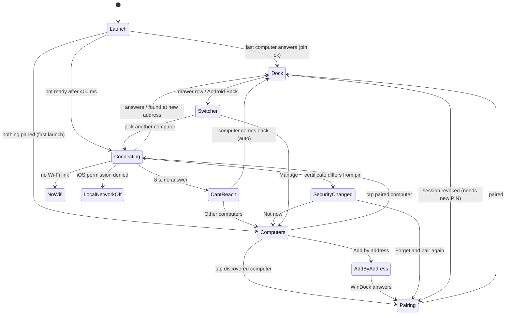

# Phone connection flow: design spec

Status: proposal, 2026-10-20. Scope: the native Android and iPhone screens around
the shared web dock: launch, the computers list, discovery, pairing, problems and
switching. The dock itself (tiles, drawer, sheets) stays in `public/` and is out
of scope, except for the one row that opens the switcher (section 11).

- Mockups: [`phone-connection-mockups.html`](phone-connection-mockups.html), one
  frame per screen. Open with `#solo=<id>` to see a single screen at its real size.
- Screenshots: [`screens/`](screens/) at 2x (index in section 15).
- Context: [`../V1-PLAN.md`](../V1-PLAN.md) (phase 4, phone shells) and
  [`../PROTOCOL.md`](../PROTOCOL.md) (health, pairing, security code).

---

## 1. Recommendation in brief

1. **One native hub, "Computers"**, replaces today's single-address connection
   screen on both platforms. It uses a two-column landscape layout: a rail on the
   left (brand, heading, secondary actions) and a scrolling list on the right.
   The list has two parts: paired computers with live status, and computers found
   on this network. First launch uses the same screen with a welcome rail, so
   there is one layout to build.
2. **Launch goes straight to the last computer.** Nothing is shown for the first
   400 ms. If the dock isn't ready by then, a quiet "Opening Studio PC" screen
   appears. If the computer moved to a new IP address, the phone finds it again
   by identity and pinned certificate, and the user sees one status line. If it
   can't be reached within 8 s, a diagnostic screen lists the likely cause first
   and keeps retrying in the background.
3. **Pairing becomes one native, two-step flow**: (1) compare the security code,
   then (2) enter the 6-digit PIN. **This moves the PIN step from the web UI into
   the native app** (decision D1). The reason is that both values come from the same
   computer screen, so one continuous flow means the user looks at the computer
   once. Native also lets us see that pairing is closed (`/health.pairingOpen`) *before*
   asking for a PIN, and wait for it to reopen by itself.
4. **Switching computers from inside the dock** uses the drawer's existing
   connection row ("Studio PC · Connected"). It becomes a button that opens a
   native "Switch computer" sheet over the live dock. On Android, system Back in
   the dock opens the same sheet. The iOS floating "…" button goes away; it covers
   dock tiles today.
5. **Security mismatch is a full screen, not an alert.** It shows both codes side
   by side and the steps to check. "Not now" is the default, and "Forget and pair
   again" is tinted, not filled.
6. **Problem states say what the phone can actually detect**: no Wi-Fi,
   a different subnet, Local Network permission off (iOS), pairing closed, or a
   lockout. Generic advice comes only after the specific cause.

---

## 2. Principles used for every call below

- **The dock is the product; these screens are a doorway.** On a good day the
  user sees none of them. Every native screen exists to get them into a dock
  or to explain, in one look, why it can't.
- **The phone never sleeps** while WinDock is open (see memory and V1 plan). Any
  native screen may sit on a desk for hours. So: no decorative loops, spinners
  stop after 60 s, and waiting screens dim after 2 minutes (section 9.4).
- **One-handed, at arm's length, landscape.** Primary actions sit low and
  are at least 48 pt tall. Body text is never under 13 pt. One primary action per screen.
- **Reuse the existing language**: #090E10 background, mint #82E8BF, the four-square
  BrandMark, the web dock's text and danger colours. No second visual language.

---

## 3. Map of screens



| ID | Screen | Platforms | Mockup |
| --- | --- | --- | --- |
| S1 | Connecting (launch, switch) | both | 01, 02 |
| S2 | Computers, first-launch variant | both | 03, 04, 05 |
| S3 | Computers (hub) | both | 06, 07 |
| S4 | Rename / Forget | both (system dialogs) | 08, 09 |
| S5 | Pairing: step 1 security code | both | 10, 11 |
| S6 | Pairing: step 2 PIN (+ wrong, locked, closed) | both | 12, 13, 14 |
| S7 | Add by address | both | 15 |
| S8 | Can't reach | both | 16 |
| S9 | No Wi-Fi | both | 17 |
| S10 | Security code changed | both | 18 |
| S11 | Local Network off | iOS | 19 |
| S12 | Switch computer sheet (+ drawer row) | both | 20, 21 |
| S13 | Connect by USB | Android | 22 |
| S14 | This phone (display) | Android | existing dialog, restyled |

---

## 4. User flows

Names in examples: **Studio PC** (Windows, renamed on the phone from
`DESKTOP-7H2KQ9L`), **Geris-MacBook-Air** (macOS, `.local` stripped from the host
name), **DESKTOP-4MF81QZ** (a new Windows computer on the network).

### 4.1 First launch, nothing paired

1. App opens to **S2**. The rail reads "Your computer. Within reach."
2. **iOS only, first run**: the list area shows the Local Network explanation
   (mockup 03) with **Continue**. Tapping it starts discovery, which triggers the
   system prompt. See decision D2. Android goes straight to step 3.
3. "On this network" shows a small spinner and "Looking". Computers appear as they
   are found, each row with a **Pair** pill (mockup 04). The whole row is the target.
4. After 8 s with nothing found, the list area shows the empty state (mockup 05).
   Discovery keeps running, and the first computer found replaces the empty state.
5. Tap a computer, go through **Pairing (4.5)**, then the dock.

### 4.2 Launch, last computer online (the everyday path)

1. Cold start: the launch screen (system splash: BrandMark centred on #090E10)
   stays up while the phone probes the last endpoint over HTTPS with the pinned
   certificate. In parallel it starts a discovery browse, so a moved computer can
   be found at the same time (4.3).
2. The pin matches and `/health.hostId` matches, so the WebView loads behind the splash.
3. If the dock's first paint comes within **400 ms** of launch, it fades in (200 ms)
   and the user never sees a native screen.
4. Otherwise **S1** fades in: BrandMark, "Opening Studio PC", a spinner,
   "Connecting…", and a text button **Choose another computer**. When the dock
   is ready, S1 fades out over it.

"Last computer" means the paired computer with the latest `lastConnectedAt`.
If several are online, the app still opens the last one; switching is one tap
away in the dock.

### 4.3 Last computer offline, or its IP changed

The phone runs two tracks at the same time from t = 0:

- **Direct**: probe the saved endpoint (2.5 s timeout).
- **By identity**: browse Bonjour `_windock._tcp` (iOS and Android) plus UDP
  discovery (Android). For every result whose host ID matches, probe it over
  HTTPS. A computer is accepted only if the TLS handshake presents the **pinned
  certificate** and `/health.hostId` matches. A matching host ID with a different
  certificate is *not* accepted (see 4.7).

Outcomes:

| Situation | What the user sees |
| --- | --- |
| Direct probe fails within 2.5 s and discovery is still running | S1 status changes to "Looking for Studio PC on this network…" |
| Found at a new address | S1 status: "Found it at a new address, 192.168.1.47" (check icon). The saved endpoint is updated, with no PIN and no confirmation. The line stays until the dock is ready (at least 600 ms so it can be read). Mockup 02. |
| Nothing after 8 s | **S8 Can't reach** (mockup 16), ordered by detected cause (section 5.8). Retries continue: direct probe with backoff 3, 5, 10, then 15 s; discovery runs continuously. Any network change retries at once. As soon as the computer answers, the dock opens with no tap needed. |
| Phone has no Wi-Fi, Ethernet or USB-tether link | **S9 No Wi-Fi**. Never shown before an attempt has failed; it is an explanation, not a gate. |
| iOS Local Network denied | **S11** |

### 4.4 Switching computers from the dock

1. The user opens the dock drawer (swipe up, as today). Its bottom row now reads
   `[monitor] Studio PC · ● Connected | Switch ⇅` and is one button (mockup 20).
2. Tap: the native **Switch computer** sheet rises over the dimmed, still-live
   dock (mockup 21). Rows: every paired computer with live status, the current one
   with a check and "Connected", then **Add a computer**. The header has **Manage**,
   which opens the full hub (S3) over the dock.
3. Tap another computer: the sheet closes, S1 fades in at once (no 400 ms grace,
   because the old dock must hide), the old WebView is torn down, and the new one loads. Then
   the same outcomes as 4.2 and 4.3. If the new computer can't be reached, S8 has
   **Other computers**, and the previous computer is one tap away there.
4. Tap the current computer, swipe down, tap the scrim, or press Back (Android):
   the sheet closes and nothing else happens.

Android Back in the dock: the topmost web sheet closes first (as today), then the
remote keyboard. With nothing open, Back opens the Switch sheet (decision D4).
A second Back closes it.

### 4.5 Pairing a newly discovered computer

1. Tap the discovered row. The phone fetches `/health` over HTTPS and reads the
   presented certificate's fingerprint, which gives the security code.
2. **S5 Step 1** (mockups 10, 11): the code is shown large, with an instruction
   matched to `/health.platform`:
   - Windows: "On DESKTOP-4MF81QZ, click the WinDock icon in the taskbar tray, by
     the clock, and choose **Show connection info**."
   - macOS: "On the Mac, open Terminal in the WinDock folder and run `npm run info`."
   - Other or unknown: "Open WinDock's connection info on DESKTOP-4MF81QZ."
3. **Codes match**: the fingerprint is pinned, and the step indicator turns 1 into a check.
4. **S6 Step 2**: if `/health.pairingOpen` is false, show the **closed** state
   right away (4.8). Otherwise show the six PIN boxes, with the number pad up and
   focus in the field.
5. On the sixth digit the phone sends `POST /api/auth` (pinned HTTPS, no `Origin`,
   `deviceName` from section 12). On 200 it moves the session cookie into the
   WebView cookie store, the caption under the boxes becomes a check and "Paired" (success haptic),
   and the dock loads behind it. Then the same fade into the dock as 4.2.
6. **They don't match**: the right column is replaced by "Don't pair with this
   computer" (copy in 5.5) with **Back to computers**. Nothing is pinned.

Hosts without TLS (`/health.tls` null, older versions): step 1 is skipped, the
indicator reads "1 of 1", and step 2 runs over HTTP as today.

### 4.6 Adding by address

1. **Add by address** in the rail (or **Enter an address** in the empty or
   priming state) opens **S7** (mockup 15). The keyboard comes up at once with
   focus in the field.
2. Entering `192.168.1.20` without a port means `:8620`, shown as ghost text after
   the caret.
3. **Connect** (or the keyboard's Go): the button shows a spinner and "Checking…".
   - Address invalid or not private IPv4: inline error, focus stays.
   - No WinDock answers in 4 s: inline error naming the address.
   - Answers and its host ID is already paired: close S7 and open that computer
     (its endpoint is updated if the pin matches; S10 if not).
   - Answers and is new: S7 is replaced by **Pairing step 1**.

### 4.7 Security mismatch

Triggered when a computer whose host ID is pinned presents a different certificate, either on launch, from the hub, or when found by identity at a new address.

1. **S10** (mockup 18): title "Studio PC has a new security code", both codes,
   and how to check. VoiceOver and TalkBack focus starts on the title. **Not now** is
   the default (it has keyboard focus and is the Escape/Back action).
2. **Not now** goes to the hub; the row shows "Security code changed. Tap to
   check." with a shield glyph. Tapping the row reopens S10.
3. **Forget and pair again** removes the pin and session for that host ID only,
   keeps the nickname, and goes to **Pairing step 1** with the *new* code. There
   the user compares against the computer. That comparison is the real check.

Milestone 3 carry-over: today a new identity *at a known address* gets the
first-contact confirmation instead of a warning. With the saved-computers list,
the rule is: **known host ID + different certificate = S10, always**; unknown
host ID = step 1.

### 4.8 Pairing window closed

Triggered when `/health.pairingOpen` is false on entering step 2, or when `POST /api/auth` returns 403 `pairing closed`.

- S6 closed state (mockup 14): clock glyph, "Pairing is closed on DESKTOP-4MF81QZ",
  the platform instruction to reopen it, and "Waiting for pairing to open" with a
  spinner.
- The phone polls `/health` every 2 s while this is visible. When `pairingOpen`
  turns true, it crossfades to the PIN boxes and raises the keyboard. No tap is needed.
- If the tenth global failure closed the window, the title stays the same and the body starts
  with "Too many wrong PINs, so DESKTOP-4MF81QZ closed pairing."

### 4.9 Wrong PIN and lockout

- 401 `wrong pin` (mockup 13): the boxes turn danger-outlined and shake once,
  with an error haptic. The message is "That PIN didn't work. Check the 6 digits on
  DESKTOP-4MF81QZ and try again." The digits stay visible so the user can compare,
  and the next keypress clears them and starts over.
- 429 `locked` (`retryInMs`): the field is disabled and the message reads "Too many tries
  from this phone. Try again in 0:48." The countdown updates every second
  as text only, and the field re-enables at 0.
- 400 `invalid pin` can't happen from the native field (digits only, length 6).

### 4.10 No network, different Wi-Fi, guest isolation

The phone can detect some of these and only suspect others. The copy matches the
confidence:

| Signal (how) | Confidence | Where it shows |
| --- | --- | --- |
| No Wi-Fi, Ethernet or USB-tether link (`NWPathMonitor` / `ConnectivityManager`) | certain | S9 |
| Phone's IPv4 subnet doesn't contain the computer's last address (interface address + prefix) | likely | S8 check 1, tagged **Likely** |
| Same subnet, probe *times out* (not refused), and discovery sees **no** WinDock at all for 8 s | possible | S8 check 3 tagged Likely, worded "often" |
| Probe refused or host down on the same subnet | likely | S8 check 2 ("WinDock is running") first |

SSID is not used: it needs location permission on Android and an entitlement on iOS.

### 4.11 iOS Local Network permission denied

- Detection: `NWBrowser` reports `.waiting` with DNS error
  `kDNSServiceErr_PolicyDenied` (-65570). Run a browser whenever a connection screen
  is up.
- **S11** (mockup 19): explanation, then **Open Settings**
  (`UIApplication.openSettingsURLString` opens WinDock's own page, which has the
  Local Network switch). On return to the foreground (`sceneDidBecomeActive`) the phone
  rechecks. If allowed, it continues where it was (launch, hub or pairing).
- There is no "Enter an address" escape hatch: direct connections fail for the
  same reason.

### 4.12 Renaming and forgetting

- **Where:** in the hub, the row's trailing button (iOS `…`, Android `⋮`) opens a
  menu. A long-press on the row does the same (iOS context menu, Android PopupMenu).
  iOS rows also have a trailing swipe action **Forget**.
- **Menu items:** iOS: *Rename*, *Forget* (destructive). Android: *Open dock*,
  *Rename*, *Forget*.
- **Rename** (mockup 08): system dialog with a text field prefilled with the
  current name. The message says only this phone uses the name, and an empty value
  restores the computer's own name. Max 40 characters. The nickname shows everywhere
  natively and is passed to the web dock (section 11).
- **Forget** (mockup 09): confirmation, Cancel by default. Forgetting removes the
  host ID's entry, pin, nickname and cookie for that origin. If it was the
  computer currently open, the dock closes and the hub becomes the root. If it was
  the last paired computer, the hub switches to the first-launch rail.
  Forgetting doesn't remove this phone from the computer's device list (decision
  D7 proposes a small host route so it can).

### 4.13 Session revoked while in the dock

When the computer revokes this phone (`npm run devices`), the dock gets 401 or the
WebSocket closes with code 1008. With the new bridge (section 11), the web UI sends
`unauthorized` instead of showing its own PIN page. Native then opens **step 2**
for that computer with step 1 already done and the title "Studio PC no longer recognizes
this phone". The security code is already pinned, so only a new PIN is needed.
Older web UIs keep showing their own PIN page, which still works.

---

## 5. Screens and states

Layout values are in pt (iOS) and dp (Android), at the two reference sizes: **844 × 390**
(iPhone 12–14 class, notch) and **932 × 430** (Pro Max / Plus class, Dynamic
Island). Android has the same proportions (most phones are 840–915 × 384–412 dp).

### Shared frame

| | 844 × 390 | 932 × 430 |
| --- | --- | --- |
| Horizontal safe inset (iOS) | 47 each side | 59 each side |
| Bottom inset (home indicator) | 21 | 21 |
| Android insets | system cutout inset, minimum 40 dp each side; system bars hidden as today | |
| Rail width | 248 | 268 |
| Rail to content gap | 32 | 40 |
| Content top padding | 20 | 24 |

Status bar hidden (iOS `prefersStatusBarHidden`, Android insets controller), as
today. The home indicator auto-hides in the dock only.

### 5.1 S1 Connecting (mockups 01, 02)

- Centred column: BrandMark 44 → 24 → title (21/600) "Opening {name}" → 8 →
  status line (15, text-2) with a 16 pt system spinner in front.
- Bottom-centred text button **Choose another computer** (ghost, accent, 48 tall),
  14 above the safe bottom. It cancels the attempt and goes to the hub.
- Status lines, in order: "Connecting…" → "Looking for {name} on this network…" →
  "Found it at a new address, {ip}" (check icon replaces the spinner).
- Accessibility: the status line is a polite live region. When it appears,
  VoiceOver focus goes to the title.

### 5.2 S2 Computers, first launch (mockups 03, 04, 05)

Same structure as S3, with this rail:

- BrandMark 26 + "WinDock" 17/600, then 28 space.
- Display 28/650 "Your computer." + line 2 "Within reach." in accent (the
  brand line from the existing screens).
- 10 space, body 15 text-2 "Open WinDock on your computer, then pick it here."
- Bottom: **Add by address** rail link (iOS). Android rail bottom: *Connect by USB*
  (with a "Windows" caption), *This phone*.

List area states:

| State | Content |
| --- | --- |
| Priming (iOS, first run, before discovery) | 56 glyph (network, accent tint), title "Find computers on your Wi-Fi", body, **Continue** (primary) + **Enter an address** (ghost). The rail hides *Add by address* to avoid saying it twice. |
| Searching, results | Section header "On this network" + right-aligned spinner "Looking". Rows. Footer caption "Don't see your computer? Check that WinDock is running on it and that both are on the same Wi-Fi." |
| Searching, nothing yet (0–8 s) | Header with spinner and no rows. The footer caption shows after 3 s. |
| Nothing after 8 s | 56 glyph (search), title "No computers found yet", body, **Enter an address** (secondary). Header caption reads "Still looking". The rail's *Add by address* is hidden while this button is visible. |

### 5.3 S3 Computers (mockups 06, 07)

- Rail: brand; display "Computers"; body "Tap one to open its dock. Each computer
  keeps its own apps." (the second sentence is dropped at 844 on Android, where
  the rail has three links). Bottom: rail links (iOS: *Add by address*; Android:
  *Add by address*, *Connect by USB*, *This phone*).
- Content: section header "Paired", then a group, then "On this network", then a group. The list
  scrolls vertically; a 28 pt fade at the bottom edge signals more.
- Presentation: **root** (from launch) has no close control. **Over the dock**
  (from the switcher's *Manage*) adds a top-left close control (iOS: 44 pt filled
  `xmark` button; Android: back arrow) and keeps the dock connected beneath it.
  Tapping a different computer there switches; closing returns to the dock.
- Ordering: paired by `lastConnectedAt`, descending; discovered by name. **Order
  is fixed while the screen is visible**, so rows never jump under a finger. A
  discovered computer that disappears stays for 10 s before it is removed.
- A discovered computer whose host ID is already paired never appears under "On
  this network"; it updates the paired row instead.

**Row anatomy** (group radius 16, row min-height 64, separators inset 68):
`[glyph 40, r12] 14 [title 17/600, 1 line, tail-truncated; subtitle 13] … [trailing]`

| Row state | Glyph | Subtitle | Trailing | Tap |
| --- | --- | --- | --- | --- |
| Online + last used | monitor, accent tint | ● Online · Last used · `192.168.1.20` | `…` | open |
| Online | monitor, accent tint | ● Online · macOS · `192.168.1.34` | `…` | open |
| Checking (first 2 s after the hub opens) | monitor, neutral | small spinner + "Checking…" | `…` | open |
| Not found | monitor, neutral | ○ Not found on this network · `10.0.4.12` | `…` | open (S1, then S8) |
| Security code changed | shield, danger tint | ● (danger) Security code changed. Tap to check. | `…` | S10 |
| Needs a new PIN | monitor, neutral | Needs a new PIN | `…` | step 2 |
| Discovered | monitor, neutral | Windows · `192.168.1.52` | **Pair** pill | pairing |

The status dot is filled for reachable and a hollow ring for not found, and it is always next to a word.
Addresses are mono 12, text-3: useful when troubleshooting, and they recede
otherwise (decision D5). On iOS the platform word replaces "Last used" when
there is no room; the address truncates first.

### 5.4 S4 Rename and Forget (mockups 08, 09)

System dialogs (they are rare actions and should feel native). Copy is in section 13.
Android: `AlertDialog` with an `EditText` (single line, `textCapWords`,
`imeOptions="actionDone|flagNoExtractUi"`, max 40) for Rename.

### 5.5 S5 Pairing step 1 (mockups 10, 11)

Full-screen modal over whatever presented it.

- Top-left: close (iOS: 44 pt filled `xmark`, label "Cancel pairing"; Android:
  48 dp back arrow and the title "Pair a computer").
- Left column (250 / 270): identity row (glyph 40 + name 17/600 + "Windows ·
  `192.168.1.52`"), 20 space, **stepper**: "1 Check the security code" (current:
  accent ring, text 15/600) and "2 Enter the PIN" (upcoming: idle ring, text-3).
- Right column: label 13/600 text-2 "Does this match your computer?", 8 space,
  **code** in mono 34/500 (38 at 932), +0.04 em tracking, hyphens in text-3. Then 18
  space, an **instruction card** (row surface, r16, 32 glyph + 13 text-2; the menu
  item name in text/600; commands in a mono chip). Then 20 space, buttons
  **Codes match** (primary) and **They don't match** (secondary).
- "They don't match" state replaces the right column: shield glyph, title "Don't
  pair with this computer", body "If the codes are different, another device on
  this network may be answering for DESKTOP-4MF81QZ. Check that you picked the
  right computer, then try again.", button **Back to computers**.

### 5.6 S6 Pairing step 2 (mockups 12, 13, 14)

The number pad takes about 45% of the height in landscape, so step 2 uses a **compact
layout** while the keyboard is up:

- Top bar 52: close/back, centred title 17/600 "Enter the PIN from {name}",
  right caption "2 of 2".
- 8 below: **PIN boxes**, 6 × (46 × 56, r12), gap 8, plus 10 extra after the third
  box. Mono 26/500 digits. The current box has a 2 pt accent ring and caret; filled and empty boxes have
  a 1 pt line-strong ring.
- 12 below: caption "It's on the same screen as the security code." (text-3).
- This is one text field drawn as six boxes, not six fields: iOS
  `UITextField` with `keyboardType = .numberPad`, `textContentType = .oneTimeCode`;
  Android `EditText` `inputType="number"`, `imeOptions="actionDone|flagNoExtractUi"`
  (prevents the full-screen landscape IME), `maxLength=6`.
- Pairs automatically on the sixth digit. There is no separate submit button: the keyboard's
  Done/✓ does the same, and VoiceOver users get it through the field's return action.

States: **entering**, **sending** (boxes at 60% opacity, small spinner replaces the caption),
**wrong** (13), **locked** (countdown), **closed** (14: shown in the two-column
layout without a keyboard; the stepper shows step 1 done), **paired** (caption becomes
a check and "Paired", then the dock).

### 5.7 S7 Add by address (mockup 15)

- Top bar: close + centred title "Add by address".
- Field row (inset 80 from the safe edges): field (52 tall, r12, mono 18,
  2 pt accent ring when focused) + **Connect** (primary, 52 tall) on the same line,
  so both stay above the keyboard.
- Caption below: "The address is in Show connection info (Windows tray) or
  `npm run info` (Mac). The port is usually 8620."
- Error replaces the caption, in danger-text with a leading icon, and is announced.
- iOS keyboard: `.numbersAndPunctuation` (has `.` and `:`), no autocorrect or
  capitalisation, return key Go. Android: `inputType="textUri"`, `flagNoExtractUi`.

### 5.8 S8 Can't reach (mockup 16)

- Left column (300 / 330): 56 glyph, title 21/600 "Can't reach {name}", body
  "WinDock keeps trying while this screen is open and opens the dock as soon as
  {name} answers.", a status line with spinner "Looking on this network" (after
  60 s: "Still looking", no spinner). Bottom: **Try again** (primary; resets the backoff
  and probes now) and **Other computers** (secondary, goes to the hub).
- Right column: up to three numbered **check cards** (row surface, r16). The
  most likely one is first, with a 1 pt accent outline and a **Likely** tag.

| Check | When it is first | Title | Body |
| --- | --- | --- | --- |
| Different network | subnet mismatch | This phone is on a different network | This phone is at `10.0.4.17`, but {name} was at `192.168.1.20`. Join the same Wi-Fi as the computer. |
| Host not running | same subnet, connection refused | WinDock is running on {name} | Windows: "Look for the WinDock icon in the taskbar tray, by the clock." Mac: "On the Mac, run `npm run mac:status` to check." |
| Isolation | same subnet, timeouts, nothing discovered | The network lets devices see each other | Guest, hotel and office Wi-Fi often keep devices apart. |
| Mac firewall (Mac host only, shown when it is one of three) | | macOS allows incoming connections | If macOS asked about node, choose Allow. You can change it in System Settings → Network → Firewall. |

Android with a Windows computer: the rail-style link **Connect by USB instead**
sits under the buttons.

### 5.9 S9 No Wi-Fi (mockup 17)

- Left: 56 glyph (wifi-off), title "This phone isn't on Wi-Fi", body "WinDock
  reaches {name} over your local network. Join the same Wi-Fi and it will connect
  by itself."
- Right, stacked 300 wide: Android: **Open Wi-Fi settings** (primary;
  `Settings.Panel.ACTION_WIFI` on API 29+, else `ACTION_WIFI_SETTINGS`),
  **Connect by USB instead** (secondary, Windows computers only), **Other
  computers** (ghost). iOS can't deep-link to Wi-Fi, so the body adds "Turn on
  Wi-Fi in Control Center." and the buttons are **Try again** (primary) and
  **Other computers**.
- Leaves by itself when a usable link appears.

### 5.10 S10 Security code changed (mockup 18)

- Left (330): 56 glyph shield on danger tint, title "{name} has a new security
  code", body (14, text-2), then buttons at the bottom: **Forget and pair again**
  (danger-tinted: danger-text on a 12% danger fill with a 30% danger-text outline)
  and **Not now** (secondary, default focus).
- Right: two code cards. "When you paired" in mono 19, text-2, and "Now" in mono
  19, text, with a 1 pt danger outline. Below: caption "To check, open Show
  connection info on {name}. If it shows the new code, pair again."
- There is no background glow on this screen, to keep it calm. Warning haptic once on appear.

### 5.11 S11 Local Network off, iOS (mockup 19)

- Left: 56 glyph (network), title "Turn on Local Network for WinDock", body.
- Right (320): instruction card "In Settings, WinDock's page opens. Turn on
  **Local Network**, then come back here.", **Open Settings** (primary, full
  width), caption "WinDock checks again when you return."

### 5.12 S12 Switch computer (mockups 20, 21)

- **Drawer row (web UI, section 11)**: min-height 48, r14, `#ffffff08` fill
  (the drawer's glass language). Layout: monitor icon 18, name 13/600 (flex),
  status (dot + "Connected", live colour), a 1 px divider, then "Switch" + up/down chevron.
  It is all one button.
- **Sheet**: 500 wide, bottom-attached, centred, top radius 24 (Android 28),
  `--sheet` surface, grabber 36 × 5. Header 44: "Switch computer" 17/600 +
  **Manage** (ghost small). Group of compact rows (min-height 56): name + status, the
  current computer with an accent check and "Connected". The last row is **Add a
  computer** (accent plus, accent label), which opens the hub with discovery.
- Height follows content, up to 85% of the screen, then scrolls. Scrim
  `rgba(3,7,9,.62)`.

### 5.13 S13 Connect by USB, Android (mockup 22)

Bottom dialog, 560 wide. Header "Connect by USB" + caption "Windows only". Three
numbered steps, a caption about mobile data, and buttons **Tethering settings** (ghost;
opens `Settings.ACTION_WIRELESS_SETTINGS`) + **Find computer over USB** (primary).
Searching state: the primary button shows a spinner and "Looking over USB…". Not found:
an inline message replaces the caption: "No computer found over USB. Check the cable
and that USB tethering is on." This replaces today's long `usb_instructions`
alert text.

### 5.14 S14 This phone, Android

Keep the existing `PhoneOptions.displayDialog` content and strings (dim after,
dim brightness, display care note). Restyle it only: `--sheet` surface, the bottom dialog
container from S13, title "This phone". Reached from the rail and from the dock
(`WinDockAndroid.showPhoneSettings`, unchanged).

---

## 6. Tokens

All values come from the existing native screens and `public/style.css`; new
values are marked *new*.

### Colour

| Token | Value | Source / use | Contrast |
| --- | --- | --- | --- |
| `bg` | `#090E10` | iOS `DockViewController` background; Android `dock_background` should change from `#0B1019` to this | |
| `bg-glow` | `rgba(74,108,83,.26)`, radial at top-left | web `body` gradient, toned down; not on S10 | decorative |
| `row` | `#13191B` *new* | list groups, cards | |
| `row-pressed` | `#1A2224` *new* | pressed row | |
| `sheet` | `#151D20` | web `.sheet` `#152023`, darkened to sit on `bg` | |
| `field` | `#171F22` | iOS address field (white 6.5% on bg) | |
| `line` | `rgba(255,255,255,.07)` | separators | |
| `line-strong` | `rgba(255,255,255,.12)` | PIN boxes, sheet edge | 3.1:1 not required (non-text) |
| `text` | `#EEF3F1` | web `--text` | 17.3:1 on bg, 15.8:1 on row |
| `text-2` | `#A0AFAF` | web `--muted` | 8.6:1 on bg, 7.8:1 on row |
| `text-3` | `#7D8C8E` *new* | captions, addresses | 5.6:1 on bg, 5.1:1 on row |
| `idle` | `#5E6E70` *new* | hollow dot ring, upcoming step ring (non-text only) | 3.6:1 |
| `accent` | `#82E8BF` | iOS mint (Android `colorAccent` `#88E9C4` should change to this) | 13.2:1 on bg |
| `on-accent` | `#0A1C1A` | iOS button label | 11.9:1 on accent |
| `accent-tint` / `accent-line` | accent at 10% / 30% | glyph tiles, pills, likely outline | |
| `live` | `#A3E6BE` | web `--live`, online dot | 12.4:1 on row |
| `danger` | `#ED9695` | web `.button--danger` | |
| `danger-text` | `#F1AAA6` | web `.pair__error` | 10.2:1 on bg, 9.3:1 on row |
| `danger-tint` / `danger-line` | danger 12% / danger-text 30% | S10, shield glyph tile | |
| `scrim` | `rgba(3,7,9,.62)` | behind sheets over the dock | |
| BrandMark | `#82E8BF` `#C7FAE8` `#80BAFF` `#69D9CC` | existing `BrandMark` | |

### Type

System fonts: SF Pro on iOS (`UIFont.systemFont`, scaled with `UIFontMetrics`),
Roboto on Android (`sans`). Mono: SF Mono (`monospacedSystemFont`) / Roboto Mono
(`monospace` family).

| Role | iOS | Android | Use |
| --- | --- | --- | --- |
| display | 28 / 650 (semibold), −0.4 tracking, 1.15 | 28 sp Medium | rail headline |
| title | 21 / 600 | 21 sp Medium | screen titles |
| headline | 17 / 600 | 16 sp Medium | row titles, top bars |
| body | 15 / 400, 1.45 | 15 sp | explanations |
| subhead | 13 / 400 | 13 sp | row subtitles, cards |
| label | 13 / 600, text-2 | 13 sp Medium | section headers, field labels |
| caption | 12 / 400, text-3 | 12 sp | hints, addresses |
| code | mono 34 / 500 (19 in cards) | Roboto Mono 34 sp Medium | security code |
| PIN | mono 26 / 500 | Roboto Mono 26 sp Medium | PIN boxes |
| address | mono 12 (rows), 18 (field) | same | |

### Spacing, radii, sizes

- Spacing scale: **4, 8, 12, 16, 20, 24, 32, 40**. Nothing off-scale except the
  14 between glyph and row text (matches web picker rows).
- Radii: **12** controls (buttons, fields, glyph tiles; web `.button`), **16**
  groups and cards, **24** sheets (web `.sheet`); Android buttons use 14 and sheets 28,
  to sit with Material 3 shapes.
- Heights: buttons **48** (small 36 for in-header only, inside a 44 hit area),
  rows **64** (compact 56), icon buttons **44 pt / 48 dp**, field 52, glyph 40
  (large 56).

---

## 7. Components

| Component | Variants | Notes |
| --- | --- | --- |
| Button | primary (accent fill), secondary (white 7%), ghost (accent text), danger-tint | 48 tall, r12, 15/600; iOS press = scale .97; Android = ripple `accent` 16% |
| Icon button | plain, filled (white 7%) | 44 pt / 48 dp; always has an accessibility label |
| Rail link | icon + label (+ caption) | 44/48 tall, accent icon, text label |
| Section header | label + optional trailing status | 32 tall |
| List group + row | standard, compact, add-row | section 5.3 |
| Status dot | filled live, ring idle, danger | 7 pt, never alone |
| Pill | "Pair" | 32 tall visual, the row is the target |
| Glyph tile | neutral, accent, danger; 40 / 56 | |
| Stepper | current, upcoming, done | rings 26 |
| Code display | large, card | mono |
| PIN field | 6 boxes, states | single field |
| Check card | normal, likely | numbered |
| Instruction card | glyph + text | |
| Sheet | bottom-attached, 500–560 wide | grabber, header |
| System dialogs | rename, forget | platform native |

---

## 8. Motion

Curves: **ease-out** `cubic-bezier(0.23, 1, 0.32, 1)` (iOS
`UIViewPropertyAnimator(duration:controlPoint1:(0.23,1) controlPoint2:(0.32,1))`;
Android `PathInterpolator(0.23f, 1f, 0.32f, 1f)`), **sheet**
`cubic-bezier(0.32, 0.72, 0, 1)`. Exits are faster than entries. Every animation starts from
the current presentation value (iOS property animators / `beginFromCurrentState`;
Android `ViewPropertyAnimator` on the live value), so a second tap retargets
and never queues.

| Trigger | Element | Properties | Duration | Easing | Interruption | Reduced motion |
| --- | --- | --- | --- | --- | --- | --- |
| Dock not ready after 400 ms | S1 content | opacity 0 → 1 | 180 ms | ease-out | dock ready mid-fade: reverse from current | same (opacity) |
| Dock ready (launch, pairing, switch) | native overlay above the painted WebView | opacity 1 → 0 | 200 ms | ease-out | new attempt: snap overlay back to 1 | 120 ms fade |
| Switching computer | S1 overlay over the old dock | opacity 0 → 1 (no 400 ms delay) | 160 ms | ease-out | picking another computer: retarget | same |
| S1 status text changes | status line | crossfade | 150 ms | ease | last change wins | same |
| S1 → problem screen (S8–S11) | screen container | crossfade | 200 ms | ease-out | auto-recovery mid-fade: reverse | same |
| Discovered row appears | row | opacity 0 → 1, translateY 6 → 0 | 200 ms, stagger 40 ms within one discovery batch (max 4) | ease-out | n/a | opacity only |
| Row removed (forget, discovered gone after 10 s) | row, then siblings | system list delete (fade, gap closes) | system (~250 ms) | system | system | system |
| Row status changes | dot + status text | crossfade | 150 ms | ease | latest wins | same |
| Pairing / Add by address opens | modal | opacity 0 → 1, scale .98 → 1 | 240 ms in / 160 ms out | ease-out | reverse from current | opacity only, 160 / 120 |
| Step 1 → step 2 (and back) | right column / whole content | outgoing translateX 0 → −16 + fade (140 ms); incoming 16 → 0 + fade (220 ms, starts at 60 ms); mirrored on back | 280 ms total | ease-out | retarget | crossfade 150 ms |
| Stepper "1" → check | step badge | crossfade | 150 ms | ease | | same |
| Wrong PIN | PIN box row | translateX 0, −10, 8, −6, 4, 0 | 320 ms | linear between keys | next keypress: jump to 0 and clear | no shake: border colour only, plus haptic |
| Paired | caption → check + "Paired" | crossfade | 150 ms, held until dock ready (min 400 ms) | ease | | same |
| Pairing closed → open | closed panel → PIN layout | crossfade (the keyboard rises with the system animation) | 200 ms | ease-out | | same |
| Switch sheet (iOS) | sheet | `UISheetPresentationController` default | system | system spring | interactive drag | system |
| Switch sheet (Android) | sheet + scrim | translateY 100% → 0, scrim 0 → 1 | 280 ms in / 200 ms out | sheet curve in, ease-out out | Back mid-open: reverse | fade only, 150 ms |
| Waiting screen idle 2 min | content | opacity 1 → .6 | 1000 ms | ease | any touch: back to 1 in 150 ms | same |
| Button press (iOS) | button | scale 1 → .97 on touch-down | 100 ms down / 160 ms up | ease-out | retarget | no scale; highlight only |
| Button / row press (Android) | ripple | system | system | | | system |
| Row press | row background | `row-pressed` instantly on, fades off | 0 / 150 ms | ease | | same |

**Deliberately not animated:** PIN digit entry (typing must feel instant);
the security code (no typewriter or reveal); hub list reordering (none happens
while visible); spinners switching to text; error text appearing (instant, then
announced); lockout countdown digits; keyboard (system); rename and forget dialogs
(system); online dots (no pulse, because the screen never sleeps and a pulsing dot on
a desk all day is noise); BrandMark (static, no loading animation).

Haptics: success (`UINotificationFeedbackGenerator.success` /
`HapticFeedbackConstants.CONFIRM` on API 30+) on paired; error (`.error` /
`REJECT`) on wrong PIN; warning (`.warning` / `REJECT`) once on S10. Haptics always
come with a visual change and never carry meaning alone.

---

## 9. Accessibility

### 9.1 Targets and contrast

- Buttons 48, rows 64/56, icon buttons 44 pt / 48 dp, PIN boxes 46 × 56. The Pair pill
  is 32 tall visually, but the target is the whole row. Rail links 44/48.
- Every text pair is AA or better (contrast column in section 6). The lowest text pair is text-3 on
  row at 5.1:1. `idle` (3.6:1) is used only for non-text marks that come with a word.
- State never relies on colour alone: dots come with words, the danger state has a
  shield glyph, the likely check has a "Likely" tag, and the current step has weight
  and a ring.

### 9.2 Screen readers

| Element | iOS (VoiceOver) | Android (TalkBack) |
| --- | --- | --- |
| Paired row | one element: "Studio PC. Online. Last used. Windows." Hint "Opens its dock." Custom actions *Rename*, *Forget* | `contentDescription` same; `AccessibilityActionCompat` for Rename/Forget |
| Row more button | "More for Studio PC" | same |
| Discovered row | "DESKTOP-4MF81QZ, Windows, not paired." Hint "Starts pairing." | same |
| Security code | label "Security code", value spelled out: `accessibilitySpeechSpellOut` attribute: "D 8 7 C, 9 2 C 9, 1 B 8 B" | `TtsSpan.VerbatimBuilder` |
| PIN field | one element: "PIN, 6 digits", value "4 8 1, 3 of 6" | same; boxes are `importantForAccessibility=no` |
| Status line (S1, S8, S6 closed) | `UIAccessibility.post(.announcement)` on change | `accessibilityLiveRegion="polite"` |
| Errors (PIN, address) | announcement + error text below the field | live region assertive |
| Screen change | `.screenChanged` with focus on the title | `sendAccessibilityEvent(TYPE_VIEW_FOCUSED)` on the title |
| Stepper | "Step 1 of 2, Check the security code, current" | same |
| Decorative glyphs, BrandMark | hidden | `importantForAccessibility=no` |

Focus order on two-column screens: title → body → right column → primary → secondary.
On S3 the order is heading → list → rail links (`accessibilityElements` / `accessibilityTraversalAfter`).

### 9.3 Text size

Support Dynamic Type up to **Accessibility Large** on iOS and font scale up to 2.0 on
Android. Above xxxLarge (iOS) or a font scale of 1.3 (Android), two-column screens
collapse into one scrolling column (rail content becomes a header above the list,
left column above right), and row subtitles wrap to two lines.

### 9.4 Always-on screen care

Screens that can wait indefinitely (S1 after 8 s → S8, S6 closed, S9, S11) stop
their spinners after 60 s and dim to 60% after 2 minutes without a touch. Android
reuses `IdleDisplayController` brightness dimming when it is enabled. Retries continue.

### 9.5 Other

- iOS Reduce Transparency: no native screen uses blur, so nothing changes.
- Keyboard and switch access (Android hardware keyboard, iOS Full Keyboard Access):
  every control is focusable; focus ring 2 px accent, 3 px offset (as the web UI).
- Orientation stays landscape-only on both platforms.

---

## 10. Platform differences

| Topic | iOS | Android |
| --- | --- | --- |
| Leaving a modal flow | top-left 44 pt filled `xmark` button | top-left back arrow + system Back |
| Back in the dock | n/a (drawer row is the way out) | closes web sheet, then remote keyboard, then opens the Switch sheet |
| Back elsewhere | n/a | modal steps go back one step; problem screens go to hub; hub leaves the app (system) |
| Row overflow | `…` button with `UIMenu`; long-press context menu; trailing swipe *Forget* | `⋮` button with `PopupMenu` (*Open dock*, *Rename*, *Forget*); long-press opens the same menu |
| Rename / Forget | `UIAlertController` (alert, with text field) | `AlertDialog` (Material dark theme from our tokens) |
| Switch sheet | `UISheetPresentationController`, edge-attached in compact height | `android.app.Dialog`, gravity bottom, custom enter/exit animation |
| Discovery | Bonjour (`NWBrowser`) | Bonjour (`NsdManager`) + existing UDP |
| Permission | Local Network (priming + denied state S11) | none needed |
| Secondary features | none | Connect by USB (Windows), This phone (display) in the rail |
| Wi-Fi settings | no deep link; copy says Control Center | Wi-Fi panel (API 29+) |
| Press feedback | scale .97 + highlight | ripple |
| Fonts | SF Pro / SF Mono | Roboto / Roboto Mono |
| Keyboard extras | `.oneTimeCode` content type on PIN | `flagNoExtractUi` on every field (landscape IME would otherwise go full screen) |

---

## 11. Touchpoints in the shared web UI

The dock remains the shared web UI. Two small, backwards-compatible changes:

1. **Native capabilities object.** Native injects at document start (iOS
   `WKUserScript`; Android `evaluateJavascript` on page start, or the existing
   `WinDockAndroid` bridge):
   `window.WinDockNative = { platform: "ios"|"android", switcher: true, computerName: "Studio PC" }`.
   The web UI uses `computerName` (the phone's nickname) in place of `hostName` in
   the drawer and the "Reconnecting to …" pill when it is present.
2. **Drawer connection row becomes a button** when `WinDockNative.switcher` is true
   (`#drawer-host`/`#drawer-conn` wrapped in one `<button id="drawer-switch">`,
   section 5.12 visuals). On tap it calls the native side (iOS
   `webkit.messageHandlers.windock.postMessage({type:"switch"})`; Android
   `WinDockAndroid.switchComputer()`).
3. **Unauthorized hand-off.** When the web app would show its PIN page and
   `WinDockNative` exists, it posts `{type:"unauthorized"}` instead (4.13).

Fallback for hosts with an older web UI: if the page hasn't posted
`{type:"ready", switcher:true}` within 3 s of load, iOS shows the legacy floating
`…` button (today's behaviour). Android always has Back.

---

## 12. Implementation notes

### Shared model (both platforms)

```
Computer {
  hostId: String          // from /health, primary key
  hostName: String        // from /health, refreshed on every contact
  nickname: String?       // phone-only, max 40
  platform: String        // windows | macos | linux
  endpoint: URL           // last https endpoint that passed the pin
  lastConnectedAt: Date?
  addedAt: Date
}
```

- Store as JSON in `UserDefaults` (iOS) / `SharedPreferences` (Android). No secrets:
  the pin stays in the existing `PinStore`, and the cookie stays in the WebView store.
- Display name = nickname ?? hostName without a trailing `.local`, max 60 (existing
  `displayName` rule).
- Migration: on first run, probe today's single remembered address
  (`windock.pcAddress` on iOS, Android `PhonePreferences`). If it answers with a host
  ID, create the `Computer` with its existing pin.
- `deviceName` for `POST /api/auth`: iOS `"iPhone"` (iOS 16+ withholds the user's
  device name without an entitlement); Android `Build.MODEL` (for example "Pixel 8"), falling back to
  "Android phone".
- **Host requirement (Bonjour TXT):** `_windock._tcp` should advertise `id=<hostId>`,
  `name`, `platform`, `api=1`. The phone still verifies everything over pinned HTTPS;
  TXT only avoids a probe per row. This is host work listed in V1 phase 4 and is
  the most expensive item here (see 14).

### iOS (UIKit, deployment target 16)

- **Structure:** a `RootViewController` owns a `ConnectionCoordinator` (state
  machine for section 3) and swaps child view controllers with a 200 ms crossfade:
  `ConnectingViewController` (S1), `ComputersViewController` (S2/S3),
  `ProblemViewController` (S8–S11, configured by a `Problem` enum),
  `DockViewController` (WKWebView only, extracted from today's file). Pairing and
  Add by address are presented `.overFullScreen` with the custom fade/scale
  transition (`UIViewControllerAnimatedTransitioning`).
- **List:** `UICollectionView` with `UICollectionLayoutListConfiguration(appearance: .insetGrouped)`,
  background cleared, cell `backgroundConfiguration` set to `row`/`row-pressed`,
  `UICollectionViewDiffableDataSource` keyed by host ID (gives the insert/delete
  animations in section 8). `trailingSwipeActionsConfigurationProvider` for Forget,
  `contextMenuConfigurationForItemsAt` for long-press, a `UIButton` with
  `showsMenuAsPrimaryAction` for `…`. Custom cell via `UIListContentConfiguration`
  is enough; the status line is an attributed secondary text.
- **Two-column layout:** `UIStackView` pairs inside a `UIScrollView` (as today), with
  `traitCollectionDidChange` collapsing to one column for large content sizes.
- **PIN:** one hidden `UITextField` (`.numberPad`, `.oneTimeCode`) behind six
  `UILabel` boxes; the container implements `UIAccessibility` as one element.
  Layout pins to `view.keyboardLayoutGuide` (iOS 15+).
- **Sheet:** `UISheetPresentationController` with
  `prefersEdgeAttachedInCompactHeight = true`,
  `widthFollowsPreferredContentSizeWhenEdgeAttached = true`,
  `preferredContentSize.width = 500`, a `.custom` detent sized to content (iOS 16),
  and `prefersGrabberVisible = true`.
- **Alerts:** `UIAlertController` for Rename (with `addTextField`) and Forget. Not for
  S5 or S10, which replace today's alerts with full screens.
- **Networking:** `NWBrowser(for: .bonjour(type: "_windock._tcp", domain: nil))`;
  `NWPathMonitor` for Wi-Fi state; `getifaddrs` for the en0 IPv4 address and netmask.
  Native `POST /api/auth` uses a `URLSession` whose delegate reuses `HealthProbe`'s
  pin check. Copy the returned `windock_session` `HTTPCookie` into
  `WKWebsiteDataStore.default().httpCookieStore.setCookie` before loading the dock.
- **Info.plist:** `NSBonjourServices = ["_windock._tcp"]`;
  `NSLocalNetworkUsageDescription = "WinDock finds and connects to your computers on this Wi-Fi."`
- **Bridge:** `WKScriptMessageHandler` named `windock` (messages `ready`, `switch`,
  `unauthorized`); `WKUserScript` at document start for `window.WinDockNative`.
- SwiftUI is not needed: every screen is a small static layout plus one list, and
  UIKit keeps one paradigm with the existing `DockViewController`.

### Android (Activity + Views + androidx.core 1.13, minSdk 24)

- **Structure:** keep the single `MainActivity`. The root `FrameLayout` holds the
  `WebView` (always at the bottom, so it survives the switch sheet) and one
  screen container above it, into which screen layouts are inflated
  (`screen_connecting.xml`, `screen_computers.xml`, `screen_problem.xml`,
  `screen_pairing.xml`, `screen_address.xml`). There are no Fragments (not a dependency).
  A small `Screen` sealed class + `show(screen)` handles the crossfade.
- **List:** a vertical `LinearLayout` inside a `ScrollView`, rows inflated from
  `row_computer.xml`. Paired lists are small (under 10), so **no RecyclerView**
  (it isn't a dependency, and adding it isn't worth it here). Insert/remove
  animation via `LayoutTransition` with `APPEARING` set to the alpha+translation
  animator from section 8 and `CHANGING` disabled.
- **Shapes and press:** `res/drawable` XML `shape` + `ripple` for buttons, rows,
  glyph tiles, PIN boxes and fields, using `values/colors.xml` tokens (add all the
  tokens from section 6; change `dock_background` to `#090E10` and `colorAccent` to
  `#82E8BF`).
- **Menus and dialogs:** `android.widget.PopupMenu` for the row overflow;
  `android.app.AlertDialog` with a custom dark theme
  (`Theme.Material.Dialog.Alert` + token colours) for Rename and Forget. The Switch
  sheet, USB and This phone use an `android.app.Dialog` with a custom layout,
  `window.setGravity(BOTTOM)`, width 500/560 dp, `windowAnimations` style with
  slide/fade XML animators (sheet curve via `pathInterpolator` XML).
- **PIN:** one `EditText` (`inputType="number"`, `maxLength=6`,
  `imeOptions="actionDone|flagNoExtractUi"`, transparent, 1 dp) behind six
  `TextView` boxes; the container is `importantForAccessibility=yes` with a
  `contentDescription` that updates.
- **Networking:** `NsdManager.discoverServices("_windock._tcp", PROTOCOL_DNS_SD, …)`
  alongside existing `Discovery.kt` UDP; `ConnectivityManager.registerDefaultNetworkCallback`
  for Wi-Fi state and `LinkProperties.linkAddresses` for subnet (no location
  permission). Native `POST /api/auth` over `HttpsURLConnection` with the existing
  `HostTrust` pin check. Then
  `CookieManager.getInstance().setCookie(origin, setCookieHeader)` and **`flush()`**,
  which also closes the milestone 3 carry-over about cookie flush on force-stop.
- **Back:** keep the existing `onBackPressed` chain and change only its last step
  from `failConnection(R.string.choose_pc)` to opening the Switch sheet. Move to
  `OnBackPressedDispatcher` only if androidx.activity is added later; not needed now.
- **Motion:** `ViewPropertyAnimator` with `PathInterpolator(0.23f, 1f, 0.32f, 1f)`.
  System "Remove animations" (animator duration scale 0) automatically collapses these,
  so reduced motion comes for free. The shake uses `ObjectAnimator.ofFloat(view,
  TRANSLATION_X, 0, -10dp, 8dp, -6dp, 4dp, 0)` and is also scaled.
- **Bridge:** add `@JavascriptInterface fun switchComputer()` and
  `fun unauthorized()` to the existing `WinDockAndroid` interface. Inject
  `window.WinDockNative` in `onPageStarted`.

---

## 13. Copy deck

Style: plain, warm, sentence case, no "please", no exclamation marks. `{name}` is
the display name. Platform-specific lines are marked.

| Key | Text |
| --- | --- |
| connecting.title | Opening {name} |
| connecting.status.connecting | Connecting… |
| connecting.status.looking | Looking for {name} on this network… |
| connecting.status.moved | Found it at a new address, {ip} |
| connecting.other | Choose another computer |
| welcome.title | Your computer. / Within reach. |
| welcome.body | Open WinDock on your computer, then pick it here. |
| priming.title (iOS) | Find computers on your Wi-Fi |
| priming.body (iOS) | WinDock looks for computers on your local network and only talks to them there. iOS will ask you to allow this next. |
| priming.continue (iOS) | Continue |
| hub.title | Computers |
| hub.body | Tap one to open its dock. Each computer keeps its own apps. |
| hub.section.paired | Paired |
| hub.section.network | On this network |
| hub.searching | Looking |
| hub.searching.long | Still looking |
| hub.foot | Don't see your computer? Check that WinDock is running on it and that both are on the same Wi-Fi. |
| hub.empty.title | No computers found yet |
| hub.empty.body | Make sure WinDock is running on your computer and both devices are on the same Wi-Fi. Guest networks often keep devices from seeing each other. |
| hub.add | Add by address |
| hub.enterAddress | Enter an address |
| row.online / lastUsed / checking | Online / Last used / Checking… |
| row.notFound | Not found on this network |
| row.securityChanged | Security code changed. Tap to check. |
| row.needsPin | Needs a new PIN |
| row.pair | Pair |
| row.menu | Open dock (Android) · Rename · Forget |
| rename.title | Rename computer |
| rename.message | Only this phone uses this name. Leave it empty to use {hostName}. |
| rename.save / cancel | Save / Cancel |
| forget.title | Forget {name}? |
| forget.message | To connect again, you'll check the security code and enter a new PIN. Your dock stays on {name}. |
| forget.confirm | Forget |
| pair.close.label | Cancel pairing |
| pair.title (Android top bar) | Pair a computer |
| pair.step1 / step1.done / step2 | Check the security code / Security code checked / Enter the PIN |
| pair.code.label | Does this match your computer? |
| pair.code.windows | On {name}, click the WinDock icon in the taskbar tray, by the clock, and choose Show connection info. |
| pair.code.mac | On the Mac, open Terminal in the WinDock folder and run npm run info. |
| pair.code.other | Open WinDock's connection info on {name}. |
| pair.match / noMatch | Codes match / They don't match |
| pair.noMatch.title | Don't pair with this computer |
| pair.noMatch.body | If the codes are different, another device on this network may be answering for {name}. Check that you picked the right computer, then try again. |
| pair.noMatch.back | Back to computers |
| pin.title | Enter the PIN from {name} |
| pin.hint | It's on the same screen as the security code. |
| pin.label (a11y) | PIN, 6 digits |
| pin.wrong | That PIN didn't work. Check the 6 digits on {name} and try again. |
| pin.locked | Too many tries from this phone. Try again in {m:ss}. |
| pin.paired | Paired |
| pin.revoked.title | {name} no longer recognizes this phone |
| closed.title | Pairing is closed on {name} |
| closed.body.windows | Choose Show connection info from the WinDock tray icon. That opens pairing for 10 minutes, and this screen continues by itself. |
| closed.body.mac | Run npm run info on the Mac. That opens pairing for 10 minutes, and this screen continues by itself. |
| closed.budget (prefix) | Too many wrong PINs, so {name} closed pairing. |
| closed.waiting | Waiting for pairing to open |
| address.title | Add by address |
| address.label (a11y) | Computer address |
| address.placeholder | 192.168.1.20:8620 |
| address.hint | The address is in Show connection info (Windows tray) or npm run info (Mac). The port is usually 8620. |
| address.connect / checking | Connect / Checking… |
| address.invalid | Enter a local address like 192.168.1.20:8620. |
| address.public | WinDock only connects to computers on your local network, like 192.168.x.x or 10.x.x.x. |
| address.noAnswer | No WinDock answered at {address}. Check the address and that WinDock is running. |
| reach.title | Can't reach {name} |
| reach.body | WinDock keeps trying while this screen is open and opens the dock as soon as {name} answers. |
| reach.status / long | Looking on this network / Still looking |
| reach.retry / other | Try again / Other computers |
| reach.likely | Likely |
| check.subnet.title / body | This phone is on a different network / This phone is at {phoneIp}, but {name} was at {hostIp}. Join the same Wi-Fi as the computer. |
| check.running.title | WinDock is running on {name} |
| check.running.windows / mac | Look for the WinDock icon in the taskbar tray, by the clock. / On the Mac, run npm run mac:status to check. |
| check.isolation.title / body | The network lets devices see each other / Guest, hotel and office Wi-Fi often keep devices apart. |
| check.firewall.title / body (Mac) | macOS allows incoming connections / If macOS asked about node, choose Allow. You can change it in System Settings → Network → Firewall. |
| wifi.title | This phone isn't on Wi-Fi |
| wifi.body | WinDock reaches {name} over your local network. Join the same Wi-Fi and it will connect by itself. |
| wifi.body.ios (append) | Turn on Wi-Fi in Control Center. |
| wifi.settings (Android) | Open Wi-Fi settings |
| wifi.usb (Android, Windows) | Connect by USB instead |
| changed.title | {name} has a new security code |
| changed.body | That's expected if WinDock was reinstalled or reset on {name}. If it wasn't, another device may be pretending to be it. Don't continue until you've checked. |
| changed.then / now | When you paired / Now |
| changed.howto | To check, open Show connection info on {name}. If it shows the new code, pair again. |
| changed.forget / notNow | Forget and pair again / Not now |
| lan.title (iOS) | Turn on Local Network for WinDock |
| lan.body (iOS) | WinDock needs it to find your computers and talk to them on your Wi-Fi. Nothing leaves your network. |
| lan.step (iOS) | In Settings, WinDock's page opens. Turn on Local Network, then come back here. |
| lan.open / recheck (iOS) | Open Settings / WinDock checks again when you return. |
| switch.title / manage / add | Switch computer / Manage / Add a computer |
| switch.connected | Connected |
| drawer.switch (web) | Switch |
| drawer.switch.label (a11y) | {name}, connected. Switch computer |
| usb.title / caption (Android) | Connect by USB / Windows only |
| usb.step1–3 (Android) | Plug this phone into the Windows computer with a USB data cable. / Turn on USB tethering in Android settings, under Hotspot & tethering. / Keep WinDock running on Windows. |
| usb.data (Android) | Tethering can share this phone's mobile data with the computer. Turn off mobile data if you don't want that. |
| usb.settings / find / searching (Android) | Tethering settings / Find computer over USB / Looking over USB… |
| usb.notFound (Android) | No computer found over USB. Check the cable and that USB tethering is on. |
| dock.prepareFailed | Couldn't open the dock. Try again, or choose another computer. *(replaces "Couldn't prepare the dock. Please try again.")* |
| dock.timeout | The dock took too long to load. Check that WinDock is still running on {name}, then try again. |

Existing strings to retire: `retry` ("Connect by Wi-Fi"), `connect` ("Use this
address"), `mode_wifi` / `mode_usb`, `choose_pc`, `usb_instructions`, `usb_not_found`,
`find_usb_pc` ("Find USB PC"), `usb_address_hint` ("PC USB address"), and the iOS
hint "Find the address WinDock shows…". USB copy says "Windows computer"
because USB mode is Windows-only.

---

## 14. Decisions and open questions for the lead

| # | Decision | Recommendation | Alternative | Cost |
| --- | --- | --- | --- | --- |
| **D1** | Move the PIN step native | **Yes.** One flow, one look; can see `pairingOpen` before asking and wait for it; native errors and haptics. Web PIN page stays for browsers, old shells and fallback. | Keep the web PIN page: native ends after "Codes match" and the WebView shows the PIN page (two visual languages, closed-window only discovered after typing). | Medium: native `POST /api/auth` with pinned TLS + cookie hand-off into the WebView store on both platforms |
| **D2** | iOS Local Network priming screen | **Yes**, first run only. A denied cold prompt costs a trip to Settings. | Start browsing at launch and let iOS prompt over the welcome screen. | Small |
| **D3** | Switch entry inside the dock | **Drawer connection row** (discoverable, already shows the name, no tile overlap) | Keep a floating native button (covers tiles; feels bolted on) | Small web change + bridge |
| **D4** | Android Back with nothing open in the dock | **Open the Switch sheet.** Accidental edge-swipes in landscape are common, and leaving the dock costs a reconnect. | Go straight to the hub (today's behaviour), tearing down the dock | Trivial |
| **D5** | IP addresses in rows | **Show, mono, text-3** | Hide (cleaner, but troubleshooting loses context) | none |
| **D6** | Native background | **Flat `#090E10` + faint top-left glow** (matches existing native screens; dock themes vary per host) | Match the dock's wallpaper | none |
| **D7** | Forget also unpairs on the computer | **Add a session self-revoke route** (`DELETE /api/session`, session cookie). Forget then also removes the phone from the computer's list, and the copy adds "This phone will also be removed from {name}." | Phone-only forget (current spec copy) | Small host change + oracle |
| **D8** | Waiting screens dim after 2 min | **Yes** (screen never sleeps) | Leave at full brightness | Small |

Expensive or risky items to plan for:

- **Bonjour advertising on the host** has no Node built-in. macOS can run `dns-sd -R`
  as a child process; Windows needs `DnsServiceRegister` through the C# helper
  (Windows 10 1809+). iOS discovery depends on it, and Android can keep using UDP
  until it lands.
- **Cookie hand-off** must preserve `HttpOnly`/`Secure` and the origin exactly, or the
  dock bounces to the PIN page. Cover it with an instrumented test on both platforms.
- **Subnet heuristics** are hints, never gates. Make sure S8 never blocks a
  connection that would have worked.

---

## 15. Screenshot index

All in `docs/design/screens/`, 2x scale (1688 × 780 for 844 × 390 frames,
1864 × 860 for 932 × 430).

| File | Screen | Device |
| --- | --- | --- |
| `01-launch-connecting.png` | S1 opening the last computer | iPhone 844 |
| `02-launch-new-address.png` | S1 found at a new address | iPhone 844 |
| `03-first-launch-priming.png` | S2 Local Network priming | iPhone 844 |
| `04-first-launch-found.png` | S2 computers found | iPhone 844 |
| `05-first-launch-empty.png` | S2 nothing found | Android 844 |
| `06-computers-ios.png` | S3 hub, all row states | iPhone 932 |
| `07-computers-android-menu.png` | S3 hub with row menu | Android 844 |
| `08-rename.png` | S4 rename | iPhone 844 |
| `09-forget.png` | S4 forget | iPhone 844 |
| `10-pair-code-windows.png` | S5 security code, Windows host | iPhone 844 |
| `11-pair-code-mac.png` | S5 security code, Mac host | Android 932 |
| `12-pair-pin.png` | S6 PIN entry | iPhone 844 |
| `13-pair-pin-wrong.png` | S6 wrong PIN | Android 844 |
| `14-pair-closed.png` | S6 pairing closed | iPhone 844 |
| `15-add-by-address.png` | S7 add by address | iPhone 844 |
| `16-cant-reach.png` | S8 can't reach, different network | iPhone 932 |
| `17-no-wifi.png` | S9 no Wi-Fi | Android 844 |
| `18-security-changed.png` | S10 security code changed | iPhone 844 |
| `19-local-network-denied.png` | S11 Local Network off | iPhone 844 |
| `20-dock-drawer.png` | S12 drawer row as switcher | iPhone 932 |
| `21-switcher-sheet.png` | S12 switch computer sheet | iPhone 932 |
| `22-usb-sheet.png` | S13 connect by USB | Android 844 |

To regenerate, open each frame with `phone-connection-mockups.html#solo=<id>` at the
frame's size and 2x scale in any Chromium-based headless browser, for example
`chrome-headless-shell --headless --force-device-scale-factor=2
--window-size=844,390 --screenshot=screens/<id>.png "file://…/phone-connection-mockups.html#solo=<id>"`.
